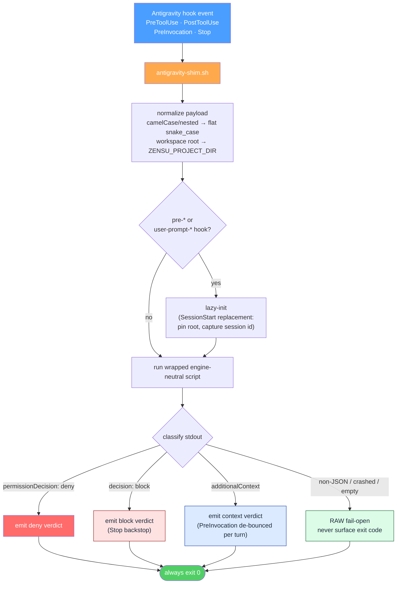
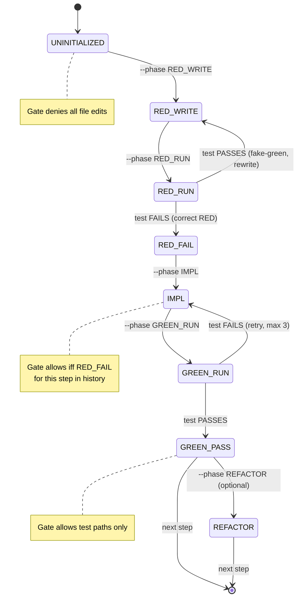

# Zensu for Antigravity


**Zensu — a Product Lifecycle Manager plugin for Google Antigravity.** It makes features
first-class citizens across the whole development lifecycle: feature tracking with `KEY-N`
ids, strict RED→GREEN TDD behind a phase-gated edit guard, a five-perspective code-review
chain, security reviews with STRIDE threat models, release-readiness gating, and
greenfield/brownfield onboarding. It ships as a native Antigravity plugin — a `plugin.json`
manifest with `skills/`, `rules/`, `workflows/`, `agents/`, and event hooks — and drives
Zensu through the typed [`zensu` CLI](https://zensu.dev) (≥ 0.2.0). The plugin ships **no MCP
configuration** — every operation runs through that CLI.

> **Status:** local plugin, not yet published. Install from this checkout with `install.sh`
> (see below).

## What is Zensu?

Zensu makes **features first-class citizens** across the whole lifecycle. Three layers:

- **Planning (WHAT):** bootstrap a greenfield product from a vision (`/zensu-bootstrap`), or
  scan an existing codebase to discover and import features (`/zensu-ghost-scan`) — or, for a
  brownfield repo that *also* ships a forward plan, run the hybrid (ghost-scan what is built,
  then add the plan's not-yet-built items as `planned` features). Each feature lands in Zensu
  with a security profile, journeys, tiers, and a v1 build-out baseline.
- **Implementation (HOW, securely):** strict RED→IMPL→GREEN TDD enforced by a phase-gated
  edit guard, followed by a five-perspective code-review chain and an auto-fix loop.
- **Tracking (HOW progress is measured):** the Zensu web dashboard — security scores, the
  tier matrix, journey health, coverage trends.

Feature IDs are `KEY-N` (e.g. `ZEN-42`, referenced in commits as `[ZEN-42]`); the lifecycle
is `planned → in-progress → testing → released`, gated by security score, docs completeness,
and journey health.

## Architecture & Workflow

Every hook is registered as `antigravity-shim.sh <script>.sh`. The **antigravity-shim** is
the only host-translation layer: it normalizes the Antigravity payload to the flat
snake_case the engine-neutral scripts read, runs the wrapped script, classifies its stdout
(`deny | block | context | raw`), and emits a top-level Antigravity verdict — always exiting
`0` (fail-open), so a crashed hook can never become an accidental deny.



The `/zensu-tdd` skill runs strict Test-Driven Development in the main thread. Before any
edit, the agent declares the current phase; the `pre-edit-tdd-reminder.sh` PreToolUse gate
allows or denies each file-edit tool call by phase. The invariant: `IMPL` requires a prior
`RED_FAIL` marker for the same step — no production code without a failing test on record.



With `hooks.tddImplementation:false` (the default, **vanilla**) the RED→GREEN ceremony is
dropped and the gate passes through; set it `true` for the strict gate. The evidence audits
and the review chain run in both modes. Full diagrams — the three-layer flow, the review
chain, the write-gates, and session-id resolution — live in
[docs/architecture.md](docs/architecture.md).

## Requirements

- **Google Antigravity** (IDE and/or the `agy` CLI)
- The `zensu` CLI ≥ 0.2.0 (`curl -fsSL https://zensu.dev/install.sh | sh`), authenticated
  with `zensu auth login`
- `node`, `bash`, `git`
- Windows: the hooks are bash and need Git Bash (not WSL, which the Windows host cannot see)

## Install

```bash
git clone https://github.com/MKITConsulting/zensu-antigravity
cd zensu-antigravity
bash install.sh          # stage the plugin into the IDE + CLI plugin paths
```

`install.sh` stages the whole plugin subtree into the Antigravity plugin directories,
renders `hooks.json` from `hooks.json.template` with absolute paths, seeds
`~/.zensu/config.json`, and writes the `~/.zensu/plugin-root` pointer. **Restart Antigravity**
so the rules, agents, skills, and hooks load. Uninstall with `bash install.sh --uninstall`.

## Authentication

The `zensu` CLI authenticates once and caches its token:

- **OAuth browser login (recommended):** `zensu auth login` opens your browser; tokens are
  cached and refreshed automatically.
- **API key (CI/CD):** `export ZENSU_API_KEY=zsk_...` then `zensu auth login` (see
  `zensu auth --help` for the non-interactive flags). Verify with `zensu auth status`.
- **Self-host:** point the CLI at your backend with `ZENSU_API_URL` or the `--api-url` flag.

## What you get

### The `zensu` CLI

The plugin drives Zensu through the typed `zensu` CLI — feature CRUD, security analysis, tier
management, user journeys, product bootstrap, ghost scans, pulse sessions, and more
(`zensu --help`). Every command takes `--json`; `zensu <noun> <verb> --help` documents its
flags. The hosted MCP server (`mcp.zensu.dev`) still serves the Zensu web app's own assistant
but is **not** wired into this plugin.

### Skills & Workflows

Each skill is invoked through its `/zensu-<name>` **workflow** shim (type the slash command;
the workflow loads the matching skill):

| Capability | User types |
|---|---|
| Strict TDD build (RED→GREEN + review chain) | `/zensu-tdd` |
| Implement a tracked feature end-to-end | `/zensu-implement` |
| Autopilot — idea → validated PR | `/zensu-autopilot` |
| Bootstrap a product (greenfield) | `/zensu-bootstrap` |
| Ghost scan (brownfield import) | `/zensu-ghost-scan` |
| Security review (classification, STRIDE, gate) | `/zensu-security-review` |
| Self-review (chain terminus) | `/zensu-self-review` |
| Plan review (multi-perspective, pre-code) | `/zensu-plan-review` |
| PR team review (multi-agent, on a GitHub PR) | `/zensu-pr-team-review` |
| PR fix findings (resolve review threads) | `/zensu-pr-fix-findings` |
| Pulse (developer journal) | `/zensu-pulse` |
| Reset the auto-fix round counter | `/zensu-reset-review-limit` |
| Zensu Q&A / glossary | `/zensu-help` |

### Subagents (3)

| Agent | Role |
|---|---|
| **zensu-plm** | Product Lifecycle Manager — orchestrates all `zensu` CLI workflows (feature tracking, security reviews, release readiness, bootstrap, ghost scans). |
| **zensu-code-reviewer** | Read-only quality review. Standalone: walks 5 specialist perspectives (conventions, bugs, architecture, tests, security). In the `/zensu-tdd` chain: runs in fan-out consume mode, surfacing the report merged from five parallel `zensu-review-aspect` agents. Write-free tool list. |
| **zensu-review-aspect** | Single-perspective read-only reviewer. The `/zensu-tdd` chain spawns five in one parallel batch (one per perspective), then merges in the main thread. Runs zero build/test commands. |

> **Subagent execution.** When Antigravity runs a plugin subagent as an isolated agent,
> these run as isolated subagents. Where the host does not spawn an isolated subagent, each
> agent body is followed as orchestrator prose — the main agent adopts the persona inline
> and the review fan-out runs as sequential self-review passes. The set of findings is the
> same either way; wall-clock and context isolation are not.

### Rules (always-on steering)

Antigravity has no SessionStart or UserPromptSubmit hook event, so the plugin's always-on
steering lives in `rules/` (declared in `plugin.json`):

| Rule | What it steers |
|---|---|
| `rules/zensu-conventions.md` | The constitution — what Zensu is (KEY-N ids, lifecycle), the routing rule (product/feature/roadmap requests → the `zensu-plm` agent + project-context triage), and the context-compaction nudge (propose `/compact` when context gets large). |
| `rules/zensu-tdd.md` | Plan first, then ask whether to run `/zensu-tdd` before the first code edit; vanilla-vs-strict; finish the review chain. |
| `rules/zensu-write-gate.md` | Why state-mutating `zensu` commands are default-denied outside a workflow (a convention nudge, not a security boundary); reads run free. |

### Hooks (7)

Engine-neutral hook scripts wired through the shim (`hooks/antigravity/antigravity-shim.sh`),
which translates the Antigravity payload + verdict contract. Wrapped scripts:

| Hook script | Event | Role |
|---|---|---|
| `pre-edit-tdd-reminder.sh` | PreToolUse (file-edit writers) | TDD phase-gate — blocks edits that violate the RED→IMPL→GREEN FSM while a session is armed. |
| `pre-bash-zensu-gate.sh` | PreToolUse (`run_command`) | Zensu CLI write-gate — default-denies state-mutating `zensu` commands outside a workflow window or the `zensu-plm` agent; reads pass. |
| `pre-bash-source-write-gate.sh` | PreToolUse (`run_command`) | Source-write integrity gate — denies raw shell writes that clobber a tracked source file or escape the session root into a sibling checkout. |
| `user-prompt-intent-router.sh` | PreInvocation | Product-planning intent router — steers keyword-bearing prompts to the `zensu-plm` triage instead of raw CLI calls. |
| `user-prompt-tdd-reminder.sh` | PreInvocation | Per-turn TDD reminder — asks whether to run `/zensu-tdd` before the first edit on a direct code request (honors prior preference, including the multilingual fast-path literals). |
| `post-bash-witness.sh` | PostToolUse (`run_command`) | Test-run witness — records each command (exit code, stdout tail) as the evidence channel the Phase 6 audit cross-checks. |
| `stop-chain-enforcer.sh` | Stop | Review-chain backstop — holds the turn open until the review chain and `/zensu-self-review` complete. |

The PreInvocation array re-fires before every model step, so the shim de-bounces identical
advisory context per user turn. The context-compaction nudge is intentionally unwired as a
hook — its essence lives in `rules/zensu-conventions.md`, which proposes `/compact` when the
context grows large.

## Configuration (`~/.zensu/config.json`)

Seeded from [`config.example.json`](config.example.json). `hooks.*` toggles
(`tddImplementation`, `intentRouter`, `tddReminder`, `mcpGate`, `bashWriteGate`, `autoFix`,
`autoFixMaxRounds`, `selfReview`, `chainEnforcer`, …), `context.compactionNudge` /
`context.nudgeThreshold`, and `logging.timestampStyle` (`wall|relative|none`). Env escape
hatches: `ZENSU_TDD_GATE=off`, `ZENSU_MCP_GATE=off`, `ZENSU_BASH_WRITE_GATE=off`,
`ZENSU_CHAIN=off`, `ZENSU_TEST_WITNESS=off`.

`hooks.tddImplementation:false` (the **default — vanilla**) switches `/zensu-tdd` to vanilla
implementation mode: no RED→GREEN ceremony, the edit gate passes through, tests at the
agent's discretion — but the evidence audits and the review chain stay enforced. Set
`true` for the strict RED→GREEN gate. The mode is frozen per session at `--tdd-begin`.

## Enforcement & capabilities

What each mechanism does on Antigravity. Gates are **blocking** (a PreToolUse deny stops the
tool call); steering is **advisory** (it injects context, never blocks). See
[docs/architecture.md](docs/architecture.md) for the full flow.

| Mechanism | What it does on Antigravity | Kind |
|---|---|---|
| Plugin packaging | native `plugin.json` at the repo root; `install.sh` stages the subtree into the IDE + CLI plugin paths | — |
| Skills & workflows | each skill is invoked through its `/zensu-<name>` workflow shim, which loads and runs the skill | — |
| TDD phase-gate | blocks production edits before a failing test — a `PreToolUse` deny on `write_to_file` / `replace_file_content` / `multi_replace_file_content` while a TDD session is armed | blocking |
| Zensu CLI write-gate | default-denies state-mutating `zensu` commands outside a workflow window or the `zensu-plm` agent — a `PreToolUse` deny on `run_command`, classified via the CLI map; reads and `--help` pass | blocking |
| Source-write integrity gate | denies raw shell writes (`>`, `sed -i`, `tee`, heredoc, `dd of=`) that clobber a tracked source file or escape the workspace root into a sibling checkout — a `PreToolUse` deny on `run_command`; the shim exports the workspace root as `ZENSU_PROJECT_DIR` so the escape check works | blocking |
| Review auto-fix loop | after `zensu-code-reviewer` reports, Critical/Important findings are fixed in-thread under the phase-gate and the reviewer is re-spawned, up to `autoFixMaxRounds` | — |
| Stop review-chain backstop | holds the turn open until the review chain and `/zensu-self-review` complete — a `Stop` verdict via the shim | advisory unless the host honors a blocking `Stop`; then blocking |
| 3 subagents | `agents/zensu-*.md`; run as isolated subagents where the host spawns them, else as inline orchestrator prose (same findings, no context isolation) | — |
| Hook wiring & root resolution | `install.sh` renders absolute paths into `hooks.json`; the libs resolve the root via `ZENSU_PLUGIN_ROOT` > `ANTIGRAVITY_PLUGIN_ROOT` > the `~/.zensu/plugin-root` pointer | — |
| Session banner / primer | always-on prose in `rules/zensu-conventions.md` (Antigravity has no SessionStart event) | advisory |
| Session-id / pulse capture | lazy first-call init via `lazy-init.sh` on the first hook of a session (no SessionStart event) | — |
| Intent router / TDD reminder | `PreInvocation` hooks via the shim, de-bounced once per user turn | advisory |
| Plan → TDD decision | steered by `rules/zensu-tdd.md` + the per-turn TDD reminder — plan first, then ask whether to run `/zensu-tdd` before the first edit (Antigravity has no plan-approval event) | advisory |
| Context-compaction nudge | folded into `rules/zensu-conventions.md`, which proposes `/compact` when context grows large (unwired as a hook) | advisory |

## Versioning & releases

The version lives in three places that must carry the same value in the same commit:
`plugin.json`, the README `version-X.Y.Z-blue` badge, and the newest `## [X.Y.Z]` CHANGELOG
heading (commit subject `chore(release): bump version to X.Y.Z`). There is no marketplace
manifest — Antigravity has none, so there is no fourth file. See [AGENTS.md](AGENTS.md) for
the full convention.

## Repository layout

```
zensu-antigravity/
├── plugin.json              # native manifest (root)
├── hooks.json.template      # tracked; install.sh renders → hooks.json (gitignored, abs paths)
├── agents/                  # zensu-plm, zensu-code-reviewer, zensu-review-aspect
├── rules/                   # always-on steering (conventions, tdd, write-gate)
├── skills/                  # skills/<verb>/SKILL.md ×13
├── workflows/               # /zensu-<name>.md shims ×13
├── hooks/                   # hook scripts + libs + hooks/antigravity/antigravity-shim.sh
├── tests/                   # structure/ + run-all.sh
├── evals/                   # config-gate offline matrix
├── install.sh               # stage plugin, render hooks.json, seed config + pointer
├── config.example.json      # ~/.zensu/config.json template
├── CHANGELOG.md · AGENTS.md · CONTRIBUTING.md · SECURITY.md · CODE_OF_CONDUCT.md · LICENSE
```

## Troubleshooting

| Problem | Solution |
|---|---|
| `zensu` CLI not found | Install it (`curl -fsSL https://zensu.dev/install.sh \| sh`) and ensure it is on `PATH`. |
| Backend unreachable | Verify network to `https://api.zensu.dev` (or your `ZENSU_API_URL`) and that `zensu auth status` shows a logged-in session. |
| Hooks not firing after install | Restart Antigravity — the plugin loads at startup, and `hooks.json` is regenerated by `install.sh` with absolute paths. |
| A steering behavior is missing | Some steering runs as always-on `rules/` (see [Enforcement & capabilities](#enforcement--capabilities)), not per-event hooks — Antigravity has no SessionStart or UserPromptSubmit event. |
| TDD phase gate blocking a legitimate edit | Set `ZENSU_TDD_GATE=off` for that edit, or declare the correct phase via `zensu-log.sh --phase <PHASE> --step <id>` first. |

## License

**Functional Source License, Version 1.1, Apache 2.0 Future License**
([FSL-1.1-Apache-2.0](LICENSE)). Source-available; each release converts to Apache 2.0 on its
second anniversary. The full text and FAQ live at [fsl.software](https://fsl.software/). For
commercial-use questions outside the Permitted Purpose, contact
[contact@zensu.dev](mailto:contact@zensu.dev).
