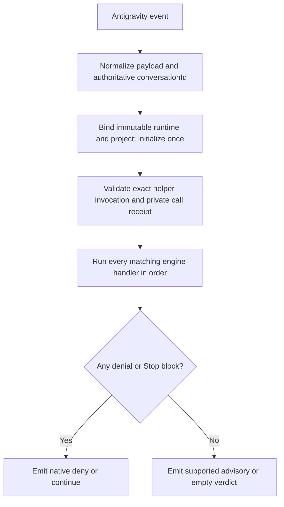

# Architecture

The engine contains workflow, evidence, review, security and delivery policy. All native
Antigravity transport and execution adaptation lives under `hooks/antigravity/`.
The upstream baseline and feature-by-feature limits are in [upstream parity](upstream-parity.md).

## Native hook pipeline

`hooks.json.template` registers four dispatchers. `hooks/hooks.json` is the engine inventory;
it is not handed directly to the native importer. The shim normalizes the tool name before
selecting every matching inventory entry. Only one native PreToolUse handler is registered,
so the CLI's one-handler behavior cannot silently discard later checks.

| Native event | Native registration | Native verdict |
|---|---|---|
| PreToolUse | One wildcard `{matcher, hooks[]}` wrapper | `deny` for refusal; `ask` for native permission handling; explicit `force_ask` is preserved; `allow` only for the audited native reviewer launch grant |
| PostToolUse | One wildcard `{matcher, hooks[]}` wrapper | `{}`; successful output evidence is retained only when observed |
| PreInvocation | Flat handler | `injectSteps` containing an ephemeral message |
| Stop | Flat handler | `decision: continue` when any engine Stop handler blocks |

A neutral/advisory PreToolUse result emits `decision: ask` with no advisory text. The native
permission path and Always Allow cache remain in charge. The explicit native reviewer grant
uses `allow` only after all gates accept, exact registered read-only profiles pass the audit,
strict configuration permits it and a protected launch receipt exists. A mixed batch,
unusable/withdrawn configuration or sibling ask/deny prevents the grant; neutral core
`allow` results never approve unrelated tools.
The required decision cannot be omitted: a real gate-disabled control proved that `{}` is
treated as a denial with an empty reason. A successful earlier deny survives a later crash, allow
or advisory. Known enforcement scripts' blocking exit code 2 becomes a sanitized denial.
Unknown malformed output is never treated as evidence of success or as an invented denial.

## Plugin-owned instructions

The native rule channel loads the installed `rules/AGENTS.md` without a manifest `rules`
key. This was observed on agy 1.4.2 through plugin-directory and plugin-entry discovery,
with isolated controls; the agy 1.1.10 inert-directory observation is historical. The
policy covers current workflow routes, explicit approval, direct-choice preservation,
evidence and native child authority. It is staged as product content and included in the
runtime digest. The user's workspace AGENTS.md and this repository's development AGENTS.md
are not overwritten or substituted. Rules steer the model; hook/helper receipts enforce
state, read capability and completion. Installed-artifact live verification checks that the
policy is visible without tools in a fresh workspace, not merely present on disk.

Delivery routing applies the user's own request preference before the recorded
`/zensu-delivery-route` marker, then `hooks.defaultDeliveryRoute`, then `ask`. The native
main thread applies the explicit plan-approval procedure; PreInvocation alone cannot
approve a plan. Only a successful bound record call persists a workflow answer. Direct
answers and typed per-request preferences do not write a session marker. The separate
`autoTdd` and `tddReminder` flags still disable their respective readers; see
[configuration](configuration.md#hook-opt-out) for the question and disclosure contract.

## Session identity and bootstrap

The host's `conversationId` is authoritative. The adapter records canonical project and plugin
roots, runtime digest and workflow identity in the private native store. There is no PPID or
shared current-session fallback. Repeated events bind the existing record; a missing baseline
is an error, not a reason to silently recreate it. State transitions use the engine's locking,
schema validation and compare-and-swap controls.

The first successful registration dispatches the supported startup steering: evidence discipline,
prompt ledger, best-solution guidance, pulse, banner, primer and autopilot resume. Context is
injected through PreInvocation; if first encountered elsewhere, supported context is deferred
privately. This is lazy initialization, not a native SessionStart event. No source-host child,
compact or SessionEnd event is synthesized; native child lifecycle uses the separately
verified parent spawn step, child metadata and actual child Stop.

Native `transcriptPath` is read only when it belongs to the current conversation and contains
recognized native user records. Tool steps are correlated by conversation and step index. Missing
exit/result fields remain missing; tool completion by itself is not a passing test receipt.

## Helper authority

Model instructions carry the exact installed helper path and raw conversation UUID. The
PreToolUse guard validates a standalone literal command, checks the host conversation, and mints
a private one-use receipt for the exact helper and arguments. Structured stdin uses a bounded
regular file, whose hash is included in the receipt. The wrapper consumes this receipt, clears
caller-selected environment authority and reconstructs the bound internal context.

Direct state modules, conflicting selectors, nested protected commands, compound helper commands
and shell substitutions are rejected. The command parser is an accident guard, not an OS sandbox.
The main conversation remains trusted; native child principals are reconstructed only from
verified host lineage. Model-supplied IDs cannot acquire reviewer authority.

## Gates

Every tool first passes the session/principal gate and also passes the work-order gate.
Native writers run the private plugin-data guard, optional strict TDD phase gate and secret scan.
Shell commands run typed Zensu mutation classification, the optional source-write gate, the
independent secret scan and browser consent policy. Denials are aggregated before native output.
See [gate semantics](gates.md) for the exact policy and limitations.

Strict mode requires RED_FAIL evidence for the same step before IMPL edits. Vanilla is the
default and removes phase ceremony while retaining the evidence and review chain. Full-suite
and acceptance evidence are required by default at chain completion. Actual exits, source-tree
fingerprints, requirements and current generation decide those verdicts.

## Review chain

The default lean review reads correctness, design and security perspectives; full mode reads
conventions, bugs, architecture, tests and security. Finding verification, critical reproduction,
judge/challenge, round convergence and terminal self-review retain the source policy. With hooks.reviewConvergence a re-review routes only CRITICAL findings and the
IMPORTANT findings the judge raised, tagged [NOT FIXED] or cited on code the previous fix pass edited,
subject to the configured severity threshold and fresh verification. Under the default critical
threshold IMPORTANT findings are parked for terminal self-review; with self-review disabled they
remain routable. Enabled critical reproduction requires a failing test for a re-review CRITICAL;
NOT-REPRODUCED and NOT-TESTABLE findings remain visible under Open and do not auto-fix.

A native `invoke_subagent` batch launches the fixed reviewer types with inherited model and
workspace. A fresh ticket opens a lease bound to the runtime, source tree, generation, expiry
and required roles. Each actual child must match its parent spawn descriptor and complete
normally. Report submission keeps the raw child results unchanged, checks their protected
receipts and consumes the one-shot ticket. The lead's separately verified merged report and
ledger drive canonical routing. A reproduction-test edit invalidates the tree and requires
a fresh ticket and full required-role re-review, not a reset or recycled receipt.

Plan/PR reviewers use canonical private exact-file/safe-root evidence leases: register before
dispatch, enforce every read, capture each normal child final JSON, finalize the whole
generation, collect exact child/role results and close. Generic advice and Gauntlet critics
use protected `review-children` collection; artifact snapshots remain the caller's obligation
when current-source verification is unavailable. Receipt validation proves execution and
provenance, not that no defect or relevant evidence was missed.

## Delivery and workers

The canonical engine retains explicit delivery route, durable autopilot transitions, release and
adoption refusal rules, work-order lease ownership, ordered status delivery and bounded recovery.
The native harness first prepares a real conversation; the external claimant must bind that
UUID before execution resumes it. An exit code of zero alone is not a successful order: the
runtime must hold a delivered successful terminal record for that exact order.

## Evidence discipline

Claims require actual observed tool or artifact evidence. `--evidence-run` owns the process and
records its real result and source-tree fingerprints. Required full-suite and acceptance checks
cannot be satisfied with prose, stale receipts or a missing baseline. Explicit escapes remain
visible; deferred CI remains deferred until a matching CI result exists.

## Verification status

Deterministic tests cannot prove native registration or runtime invocation. The live suite uses
an installed copy, its unmodified shim and a logged-in host. It correlates shared logs with its
own temporary workspace and records each script's `ran` or `bail-*` outcome.

Write probes use paired disabled/enabled controls and exact command/content hashes plus resulting
file state. Stop probes require a real block and resumed invocation. Missing tool action reports
`LIVE-INCONCLUSIVE`; unmatched shared logs report `LIVE-UNAVAILABLE`. Neither is a verified pass.
The final validation report contains the current run's results, rather than this document claiming
success before the probes have completed.

Remaining host limits include unverified IDE execution, absent native exclusive-session ownership, and no native equivalent for source-host
Desktop/account/task-chip/worktree-archive receipts. Browser ask/force_ask is documented; its
complete interactive consent-to-success cycle requires its own live evidence.

## Explicit plan approval

After the user approves the exact saved plan, ask which delivery route the plan takes:
`/zensu-autopilot`, `/zensu-tdd`, `/zensu-pilot`, or implementing directly. Preserve exactly
these four options and rank the applicable long-term route first; direct implementation
never leads. Explicit preferences and the recorded session route keep their canonical
precedence. Non-interactive routing never selects Autopilot or Pilot. PreInvocation supplies
the generic code-request reminder; no native ExitPlanMode approval callback is invented.
