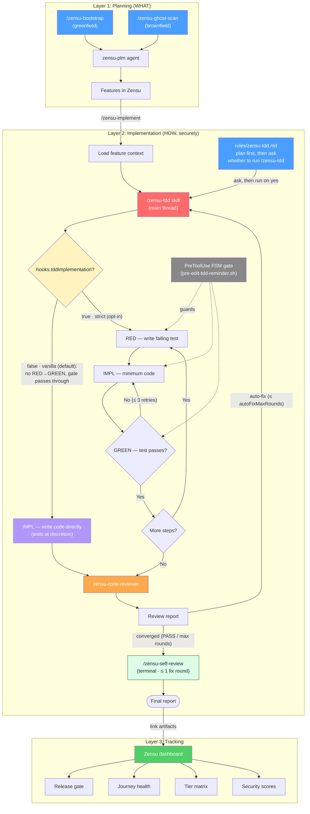
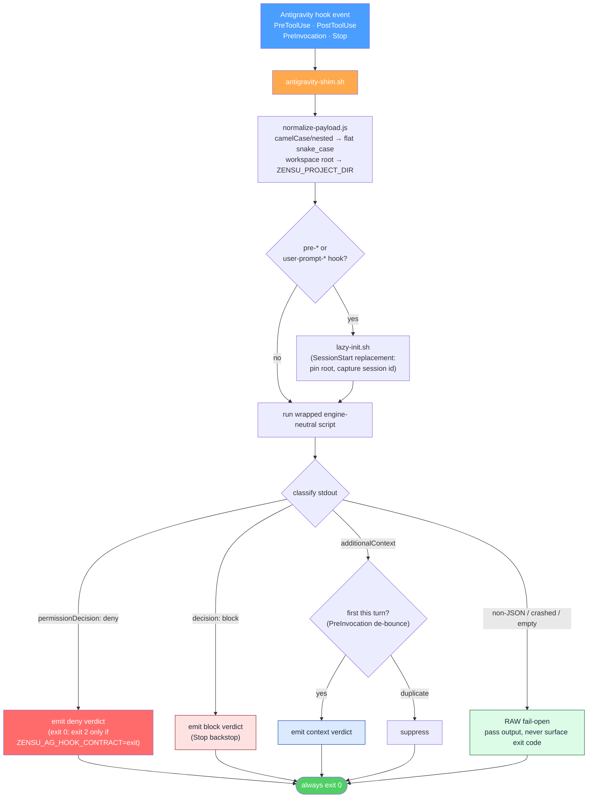
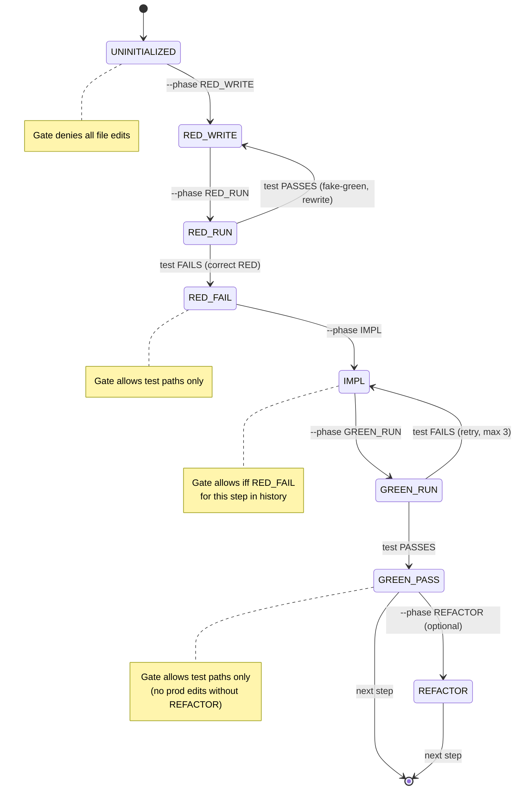
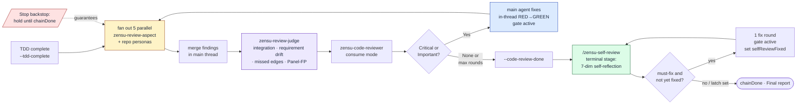

# Architecture

How the Zensu plugin is wired into Google Antigravity: the hook pipeline, the
write-gates, the TDD state machine, the review chain, and session-id resolution.

Zensu is a **Product Lifecycle Manager** plugin for Antigravity. It packages
three layers — Planning (WHAT), Implementation (HOW, securely), and Tracking
(HOW progress is measured) — as a native `plugin.json` manifest with `skills/`,
`workflows/`, `agents/`, `rules/`, and event hooks. Everything the plugin does
against Zensu goes through the typed `zensu` CLI.

## The three layers



The Implementation layer shows both modes. **Vanilla**
(`hooks.tddImplementation`, default `false`) skips the RED→GREEN ceremony and
lets the edit gate pass through; set it `true` for the strict phase-gate. The
review chain and the evidence audits run in both modes. On Antigravity there is
no plan-approval event, so the plan→TDD decision is steered by
`rules/zensu-tdd.md` and the per-turn `user-prompt-tdd-reminder.sh` advisory,
which ask whether to run `/zensu-tdd` before the first edit.

## The hook pipeline

Every hook is registered in `hooks.json` as
`bash <root>/hooks/antigravity/antigravity-shim.sh <script>.sh`. The
**antigravity-shim** is the only host-translation layer: the wrapped scripts
under `hooks/` are engine-neutral and never see an Antigravity-shaped payload or
emit an Antigravity-shaped verdict — the shim does both.

The shim pipeline for one hook invocation:

1. **Resolve the plugin root** from `$0` and export `ZENSU_PLUGIN_ROOT` /
   `ANTIGRAVITY_PLUGIN_ROOT` so the wrapped script and the libs it sources
   self-resolve.
2. **Normalize the payload** (`normalize-payload.js`): the Antigravity
   `toolCall.*` camelCase / nested shape becomes the flat snake_case the neutral
   scripts read. The workspace root is emitted as line 1 and exported as
   `ZENSU_PROJECT_DIR`, so project state anchors on the workspace — not the
   command's cwd (this is what lets the source-write gate detect a cross-worktree
   escape).
3. **Lazy init** (`lazy-init.sh`, on `pre-*` / `user-prompt-*` hooks only): the
   session-start replacement — pins the plugin-root pointer and captures the
   session id on the first call of a session, since Antigravity has no
   SessionStart event.
4. **Run the wrapped script** on the normalized payload, capturing its stdout,
   stderr, and exit code.
5. **Classify the stdout** into one of `deny | block | context | raw`.
6. **Emit the verdict** (`emit-verdict.js`) as top-level Antigravity JSON.



**Fail-open everywhere.** A missing or broken wrapped script, a missing `node`,
a parse error, or a *crashed* wrapped script (non-zero exit with partial output)
is classified `raw` and allowed through. The shim never surfaces the wrapped
script's exit code, so a syntax error can never become an accidental deny. This
matches the plugin's convention-nudge posture: the gates steer workflow
conventions, they are not a security boundary.

**Verdict contract.** The shim always exits `0`; a deny only escalates to
`exit 2` when `ZENSU_AG_HOOK_CONTRACT=exit`. The `Stop` backstop's block budget
is bounded by `ZENSU_AG_STOP_BLOCKS`.

**PreInvocation de-bounce.** The `PreInvocation` array re-fires before every
model step, so an advisory hook (`user-prompt-intent-router.sh`,
`user-prompt-tdd-reminder.sh`) would re-inject the same `additionalContext` on
every tool round. The shim suppresses an identical `(script, context)` pair
within the same user turn — keyed on a hash of the prompt — so the reminder
appears once per turn and re-arms on the next prompt.

### The eight wrapped hooks

| Hook script | Event | Matcher / scope | Role |
|---|---|---|---|
| `pre-edit-tdd-reminder.sh` | `PreToolUse` | `write_to_file` · `replace_file_content` · `multi_replace_file_content` | TDD phase-gate — denies edits that violate the RED→IMPL→GREEN FSM while a session is armed. |
| `pre-bash-zensu-gate.sh` | `PreToolUse` | `run_command` | Zensu CLI write-gate — default-denies state-mutating `zensu` commands outside a workflow window or the `zensu-plm` agent; reads pass. |
| `pre-write-secret-scan.sh` | `PreToolUse` | `write_to_file` · `replace_file_content` · `multi_replace_file_content` | Secret-scan gate — denies a write whose body carries a real-looking credential, naming the matched rules. Placeholders and vendor example values pass. |
| `pre-bash-source-write-gate.sh` | `PreToolUse` | `run_command` | Source-write integrity gate — denies raw shell writes that clobber a tracked source file or escape the session root into a sibling checkout, and scans the same raw write content for credentials so a heredoc cannot smuggle one past the writer gate. |
| `user-prompt-intent-router.sh` | `PreInvocation` | — | Product-planning intent router — steers keyword-bearing prompts to the `zensu-plm` triage instead of raw CLI calls. |
| `user-prompt-tdd-reminder.sh` | `PreInvocation` | — | Per-turn TDD reminder — asks whether to run `/zensu-tdd` before the first edit on a direct code request (honors a prior stated preference). |
| `post-bash-witness.sh` | `PostToolUse` | `run_command` | Test-run witness — records each command (exit code, stdout tail) as the evidence channel the completeness audit cross-checks. |
| `stop-chain-enforcer.sh` | `Stop` | — | Review-chain backstop — holds the turn open until the review chain and `/zensu-self-review` complete. |

## The write-gates

Two `PreToolUse(run_command)` gates protect the workflow conventions and the
working tree. Both are **convention-nudges, not hard boundaries** — each has an
inline escape prefix and a config flag.

**Zensu CLI write-gate** (`pre-bash-zensu-gate.sh`). The `zensu` CLI is
read-free, write-gated. A state-mutating command run directly on the main thread
is denied by default so that "freelance" writes cannot bypass the dedup,
user-journey, baseline-revision, and security-review conventions the skills
enforce. The gate parses `zensu <noun> <verb>` out of the `run_command`
`tool_input.command`, resolves each to its canonical tool name via
`hooks/lib/zensu-cli-map.sh`, and classifies it with `hooks/lib/zensu-mcp-tools.sh`
(the single read/mutation source of truth). Reads, telemetry, and `--help` always
pass. A mutation is allowed only when the caller is the `zensu-plm` agent, or the
command is declared in an active skill workflow window
(`zensu-log.sh --workflow-begin --tools "…"`), or a bypass is set
(`ZENSU_MCP_GATE=off`, honored inline as a command prefix, or `mcpGate:false`).
A write whose target backend (`--api-url` / `ZENSU_API_URL`) is localhost is never
gated — a throwaway dev DB where the conventions are meaningless.

**Source-write integrity gate** (`pre-bash-source-write-gate.sh`). The TDD
phase-gate only ever sees `write_to_file` / `replace_file_content` /
`multi_replace_file_content`; an agent could route around it with `printf >> f`,
`cat > f <<EOF`, `sed -i`, `tee`, or `dd of=`. This gate denies a raw shell write
to a source-extension file when either **(A) Clobber** — the target already
exists and is git-tracked inside the project — or **(B) Escape** — the resolved
path lands outside the session root (`ZENSU_PROJECT_DIR`, the workspace root the
shim exported, else the command's cwd) into a sibling or main checkout. Relative
targets resolve against a cwd that tracks `cd` across the command, so
`cd ../main && printf … >> src/x.rs` is caught; (B) fires even for a new file.
Never denied: a new file inside the project, gitignored/untracked files,
non-source extensions, and temp roots. Bypass a one-off with an inline
`ZENSU_BASH_WRITE_GATE=off` prefix, or disable with `bashWriteGate:false`.

## The TDD state machine

The `/zensu-tdd` skill runs strict Test-Driven Development in the **main thread**.
Before any edit, the agent declares the current TDD-FSM phase via the log helper:

```bash
bash "$ZENSU_PLUGIN_ROOT/hooks/lib/zensu-log.sh" --phase {PHASE} --step {step_id} [--reason "…"]
```

The `pre-edit-tdd-reminder.sh` PreToolUse hook reads the declared phase from the
per-session state file (`.zensu/state/tdd-phase-<session>.json`) and allows or
denies each file-edit tool call. The critical invariant: `IMPL` requires a prior
`RED_FAIL` marker for the **same step** — there is no path to production code
without a failing test on record.



Phase-to-permission matrix the gate applies:

| Phase | Production file edit | Test file edit |
|-------|---------------------|----------------|
| `UNINITIALIZED` | DENY | DENY |
| `RED_WRITE` | ALLOW | ALLOW |
| `RED_RUN` | (transient, no edits expected) | (transient) |
| `RED_FAIL` | DENY | ALLOW |
| `IMPL` | ALLOW iff this step has `RED_FAIL` in history | ALLOW |
| `GREEN_RUN` | (transient) | (transient) |
| `GREEN_PASS` | DENY | ALLOW |
| `REFACTOR` | ALLOW | ALLOW |

**Gate scope.** The gate is active only while the per-session chain-state
`active` flag is set — written by `zensu-log.sh --tdd-begin` in Phase 0 of the
`/zensu-tdd` skill. Any session with no active TDD chain-state (other main-thread
work, other subagents, plain CLI) is never gated. Bypass a legitimate non-TDD
edit with `ZENSU_TDD_GATE=off`.

**Vanilla mode.** At `--tdd-begin` the `hooks.tddImplementation` value is read
once and frozen into the state file's `vanilla` flag (the command echoes
`mode: strict` / `mode: vanilla`). While `vanilla` is `true` the gate exits right
after the `active` check — the whole phase matrix is bypassed, no phase markers
are required, and tests are at the agent's discretion. Still enforced in vanilla
mode: the Bash witness, the build/coverage/witness evidence audits, the review
chain, and the `Stop` backstop.

## The review chain

At the end of a TDD run the skill marks `--tdd-complete` and fans out five
read-only `zensu-review-aspect` agents in one parallel batch, merges their
findings in the main thread, runs one `zensu-review-judge` second pass over the
merge, and only then spawns the consolidating `zensu-code-reviewer`. The `Stop`
backstop (`stop-chain-enforcer.sh`) guarantees the chain even if that spawn is
skipped: it holds the turn open while `implComplete && !chainDone`. Findings are
routed back into the main thread to be fixed in-thread under the still-active
phase-gate, then the chain re-runs — looping until PASS or `autoFixMaxRounds`,
after which the terminal `/zensu-self-review` stage runs.

The judge exists because an aspect panel has systematic blind spots: each aspect
sees one lens, so cross-cutting integration, drift from the plan's `AC-###` /
`FR-###` requirements, and edge cases that fall between lenses go unclaimed. The
judge also grades the panel — a finding it marks `Panel-FP:` is neutralized
rather than deleted: it stays visible, is retitled, downgraded to a suggestion,
and exempted from fix routing in every severity mode. Repo-local personas
discovered by `persona-activation.js` join the same parallel batch. The stage is
config-gated by `hooks.reviewJudge` (default on).



For a direct standalone `zensu-code-reviewer` invocation the five perspectives
are walked sequentially in one read-only agent; the `/zensu-tdd` chain instead
fans them out to five parallel `zensu-review-aspect` subagents and merges the
findings in the main thread. Every finding requires a `file:line` reference and
`confidence ≥ 80`, and the reviewer must read the file before reporting.

The `Stop` backstop is **advisory** unless the host allows a blocking `Stop`:
when Antigravity honors a `decision: block` verdict, the turn is held open until
the chain terminates; where it does not, the chain still runs (the skill spawns
the reviewer at completion and the auto-fix loop proceeds) but the hard
turn-hold guarantee is relaxed to native best-effort. Disable the backstop with
`chainEnforcer:false` or `ZENSU_CHAIN=off`.

## Session-id resolution

Per-session state — the TDD FSM file, the auto-fix round counter, the witness
log, the PreInvocation de-bounce marker — is keyed on a session id. Antigravity
has no SessionStart event, so the id is captured by `lazy-init.sh` on the first
`pre-*` / `user-prompt-*` hook of a session and reused thereafter.

- **Hook subprocesses** use the normalized payload's `session_id`.
- **Main-thread skill calls** derive the id from the session transcript
  (anchored on the git worktree root), falling back to a deterministic
  `fallback_<key>` only when the transcript cannot be located.
- **Spawned subagents never block on `Stop`.** The backstop reads the
  hook-input agent identity and no-ops for reviewer subagents and orchestrated
  workers; only the genuine interactive thread enforces. Session resolution
  prefers each agent's own transcript over a newest-by-mtime fallback, so
  concurrent agents never write each other's state.

Run concurrent TDD sessions in **separate worktrees** (the default workflow):
each gets its own transcript subdir and its own `.zensu/state/`, so their FSM
state cannot cross-bind.

## Files and layout

```
zensu-antigravity/
├── plugin.json              # native manifest (root)
├── hooks.json.template      # tracked; install.sh renders → hooks.json (gitignored, abs paths)
├── agents/                  # plm, code-reviewer, review-aspect, review-judge,
│                            #   plan-review-worker, pr-review-worker
├── rules/                   # always-on steering (conventions, tdd, write-gate)
├── skills/                  # skills/<verb>/SKILL.md
├── workflows/               # /zensu-<name>.md shims
├── templates/               # artifact skeletons (tdd-plan, autopilot-spec, autopilot-pr-body);
│                            #   a repo may override each under .zensu/templates/
├── hooks/
│   ├── *.sh                 # engine-neutral wrapped scripts
│   ├── lib/*.sh             # engine-neutral helpers: log, config, session, cli-map, mcp-tools,
│   │                        #   vcs (forge driver), doctor, overlay (+ template resolver),
│   │                        #   bypass-ledger, autopilot-state, host-version
│   ├── lib/*.js             # secret-patterns + secret-scan-decide, valid-diff-lines,
│   │                        #   persona-activation, resolve-session-id, resolve-project-dir
│   └── antigravity/         # antigravity-shim.sh + normalize-payload.js + emit-verdict.js + lazy-init.sh
├── tests/                   # structure/ + run-all.sh
├── evals/                   # config-gate offline matrix + promptfoo capability proof suite
└── install.sh               # stage plugin, render hooks.json, seed config + pointer
```

**Root resolution.** Top-level `hooks/*.sh` resolve the plugin root via the chain
`ZENSU_PLUGIN_ROOT` > `ANTIGRAVITY_PLUGIN_ROOT` > self-resolve, falling back to
the `~/.zensu/plugin-root` pointer written at install. The shim exports the root
before sourcing, so the `hooks/lib/*.sh` helpers self-resolve and stay
engine-neutral.
