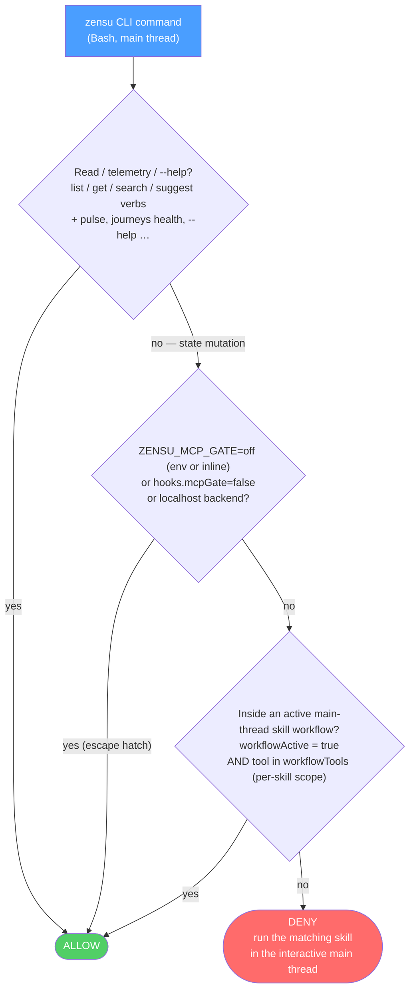

> Engine policy reference adapted from Zensu 0.27.0. Native execution uses one chained
> PreToolUse dispatcher, exact conversation binding and receipt-authorized helper calls.
> Engine command examples describe verbs; use the injected native helper prefix, never
> hand-build plugin-data/session selectors. Host-specific limits are in [upstream parity](upstream-parity.md).

# Gates

Six PreToolUse gates keep an agent inside the workflow conventions, plus TWO
completion-time `--tdd-complete` refusals of the same class: the edit-landing
receipt — whose VERDICT is what is judged, not its existence, and which a logged
claim arms even when the anchor's tree is clean (discipline patch 10 in
[tdd-manager-workflow.md](tdd-manager-workflow.md))
and §Requirements-Table Gate below, which has its own section here — and TWO
terminus refusals at `--chain-done`, §Full-Suite Gate and §Acceptance Verification Gate.
Eight of the ten are
convention-nudges with a documented escape hatch, not security boundaries — see [Session Control](session-control.md) for the part that is. The
two exceptions, §Plugin-Data Guard and §Browser Consent Gate, deliberately have no
escape hatch, and neither is a security boundary on its own: the first closes one
channel to one directory and names the ones it leaves open; the second puts a human
prompt in front of a browser origin and states in its own section what a session can
still do around it.

**Two commands stay reachable when the Session Control bind fails**, in every
bind failure including a record that exists and disagrees, and they are
recognized by `hooks/lib/zensu-doctor-invocation.js` rather than by any
individual gate: `/zensu-doctor`, which writes nothing, and
`/zensu-adopt-session`, whose writes are confined to the calling session's own
record, one workflow history entry, a move of that session's stale
review-evidence leases — on an `already-served` refusal with `--confirm`
only — that session's own missing workflow document plus its `.zensu` ancestors
under the recorded project root, and — under `--restore-root --confirm` only —
the recorded project root itself when that directory is what is gone; it carries
its own justification, and the authoritative five-class enumeration, in the header of
`hooks/lib/zensu-session-adopt.sh`. Both are matched as exact whitelisted shapes
— a closed set of assignments, one `bash <script in the executing installation>`,
and for the adoption at most the literals `--restore-root` and `--confirm`, each
at most once. Neither literal takes a VALUE, which is what keeps a destination out
of every invocation this gate admits. Every hook on the `Bash`
matcher plus the all-tool capability gate must allow, because a deny from any one
of them wins. The adoption itself no longer needs the command: every hook adopts a
compatible-schema record automatically on its first failed bind
(`hooks/lib/session-auto-adopt-v1.js`, opt-out `hooks.sessionAutoAdopt`), and the
command is the report and the manual retry for a refusal. The full account is in
[Session Control](session-control.md#unbindable-sessions).

## CLI Write-Gate

The `zensu` CLI is **read-free, write-gated**. Any state-mutating command (creating or
updating features, security classifications, tiers, journeys, revisions, …) run directly
on the main thread is **denied by default** — it must run inside a skill that declared its
work, so "freelance" writes cannot bypass the dedup, user-journey, baseline-revision and
security-review conventions the skills enforce. Reads and telemetry are always allowed.

The gate is a PreToolUse(Bash) hook (`pre-bash-zensu-gate.sh`): it parses `zensu <noun> <verb>`
out of the Bash command, resolves each to its canonical tool
name via `hooks/lib/zensu-cli-map.sh`, and classifies it with the same `hooks/lib/zensu-mcp-tools.sh`
source of truth. It reads the command twice and gates every invocation either reading finds. The
shell model of the subagent accident guard (`hooks/lib/subagent-shell-guard-v1.js`) finds an
invocation behind a wrapper such as `timeout`, `nice -n`, `env -i` or `xargs`, in a loop or `if`
body, in a `bash -c` body or a heredoc a shell reads, in `eval`, and in a command substitution,
also one inside a parameter or arithmetic expansion. The gate's own token scan splits the text at
separators such as `;`, `&&`, `|` and a line break, whatever the quoting, and keeps every
invocation it found before. So a call that follows `&&` inside an `ssh` or `su -c` command string
is gated, and a line inside a heredoc fed to `cat` that names a mutation is still denied. A search
pattern that names a mutation passes unless a separator precedes the name inside it. When the
module cannot load, the token scan runs alone. A command name assembled from variables, a call
made from interpreter code and a `find -exec` command are not seen, and a call that `ssh`, `su`,
`docker exec` or `kubectl exec` runs is seen only when a separator precedes it in the command
text. It is a **convention-nudge, not a hard boundary** — once the CLI's OAuth token
is cached on disk an agent could `curl` the backend directly; the gate enforces the workflow
conventions, not a security control (the same role, and the same `ZENSU_MCP_GATE=off` escape, as
the MCP write-gate it replaced).



A skill opens a **scoped** window with
`zensu-log.sh --workflow-begin --tools "<exact tool set>"`: the bypass then allows **only**
that skill's declared tools — so `/zensu-implement` cannot forge a `set_security_classification`
it never declared — and `--workflow-end` closes it again. The `--tools` list stays tool-name-keyed;
the gate maps each CLI command back to its canonical tool name to check membership. `ZENSU_MCP_GATE=off`
disables the gate for a deliberate one-off — honored both as a session env and as an **inline prefix**
(`ZENSU_MCP_GATE=off zensu …`). The inline prefix works on the main thread only: the gate
ignores it on a subagent's command. The gate is scoped to its threat model (a low-context agent writing to the
*real tracked product*), so it also never fires on reads or `--help`/`-h`, or on a write whose target backend
(`--api-url` flag / `ZENSU_API_URL` env) is **localhost** — a throwaway dev/test DB where the conventions are
meaningless. A subagent's mutation is denied even while a window is open, because a child never
borrows the main thread's window; its deny names neither the escape nor a retry and tells it to
report the operation to the main thread, which runs it through the matching skill. A structure
test (`tests/structure/test-skill-workflow-markers.sh`)
fails the build if any skill runs a mutation command without the `--workflow-begin` /
`--workflow-end` markers, so a new skill cannot silently regress the contract.

## Source-Write Gate

A second PreToolUse(Bash) hook (`pre-bash-source-write-gate.sh`) protects **source files** from
raw shell writes that bypass the Edit/Write tools. The Edit/Write gate (`pre-edit-tdd-reminder.sh`)
only ever sees `Edit|Write|MultiEdit`; an agent can route around it with `printf >> file.rs`,
`cat > file.rs <<EOF`, `sed -i`, `tee`, or `dd of=` — and, worse, `cd` into a sibling/main checkout
and clobber **another session's working tree**.

**The gate is opt-in.** Its three rules run only when `hooks.bashWriteGate` is `true` in the Zensu
config; absent, `false` or a quoted `"true"` leaves them off. The Session Control rebind check that
shares the hook runs whatever the key says, because it is part of the trust boundary rather than a
convention (see [Session Control](session-control.md)). The default flipped on measured evidence: a
seeded sample of 156 transcripts from September 2026 held 27 denies in 11 sessions, and none of them
stopped a real mistake. 14 blocked intended work — takeover moves out of a session the user had
handed over, commits in a session's own worktree after the host moved it, multi-repository layouts —
and 1,085 commands carried a gate-off prefix, about 40 per deny, which the host's auto-mode classifier
refused 19 times. In a desktop session observed on 2026-09-29, the host runtime itself reset the shell to
the session's worktree after every command that `cd`ed out of it, which by itself stops the
cross-command drift that motivated rule (C) below wherever the host behaves that way.

When enabled, the gate denies a write through one of those channels to a source-extension file when either:

- **(A) Clobber** — the target already **exists and is git-tracked** inside the project (a raw
  shell overwrite of real tracked source), or
- **(B) Escape** — the resolved path lands **outside the session root** (`ZENSU_PROJECT_DIR`, else
  the command's cwd) — a sibling or main checkout. Relative targets resolve against a cwd that
  **tracks `cd` across the command**, so `cd ../main && printf … >> src/x.rs` is caught. (B) fires
  even for a new file, since writing fresh source into another checkout is the breach.

git reaches that same breach without naming a write target at all — `git add -A` in a shell whose
cwd drifted back to the main checkout stages *that* repo's files — so a third rule covers it:

- **(C) Git repo escape** — a **working-tree-mutating** git subcommand whose **target repository**
  lands outside the session root. The repository is read from `git -C <path>` (relative and
  cumulative, as git resolves them), `--work-tree`/`--git-dir`, an inline, `env`-wrapper or
  `export`/`declare -x` `GIT_DIR=`/`GIT_WORK_TREE=` assignment, or the same `cd`-tracking cwd as (B). The gated verbs are the `GIT_MUTATIONS` set in
  `hooks/lib/bash-source-write-parse.js`; **reads and unknown subcommands pass**, as does every
  mutation inside your own worktree, and the read-only spellings listed in `GIT_READONLY_FORMS` are exempt.
  `git worktree` is gated for `remove`/`move` only — and judged on the tree it destroys, not on
  the repository it is addressed to, so removing a scratch worktree under `/tmp` stays ungated.
  Rule (A) is never applied to the git subcommand itself.

Never denied under (A)/(B): creating a **new** file inside the project, gitignored/untracked files,
non-source extensions. **Rule (C) applies neither filter** — it judges which repository is addressed,
so `git -C ../sibling add notes.md` is denied even though `.md` is not a source extension. Never
denied under any rule: temp roots (`$TMPDIR`, `/tmp`, `/private/tmp`, `/var/folders`; override the
set with `ZENSU_BSWGATE_TEMP_DIRS`). The standalone `mv`/`cp` commands are out of scope — `git mv`
is covered by (C) when it escapes the session root. Like the CLI gate this is a
**convention-nudge, not a hard boundary**: while it is enabled, an inline
`ZENSU_BASH_WRITE_GATE=off` (or `ZENSU_MCP_GATE=off`) prefix still bypasses a deliberate one-off, but
the deny texts no longer name that prefix — they name `hooks.bashWriteGate` and leave an intended
command to the user, because the host's auto-mode classifier refuses a command that carries it.
`tests/structure/test-bash-source-write-gate.sh` pins the behavior.

**Cross-worktree continuation while the gate is enabled.** Rules (B) and (C) compare
writes and mutating Git commands against the immutable session anchor. A sibling worktree,
another repository or a main checkout addressed from inside a worktree is outside that
anchor. A registered worktree nested inside it remains contained. The gate is opt-in;
disabling it does not change the anchor or establish ownership of another conversation.

Use `/zensu-session-trail` to inspect the source conversation's exact workspace, branch,
changes and handoff. Native `show`/`handoff` provide a continuation brief and the observed
`agy --conversation` resume command; they do not generate source-host `CONTINUE` patch/tar
recipes or implement `show --anchor`. A lineage edge is a record of an explicit handoff,
not exclusive ownership, copied changes or a repaired Session Control record. Start a fresh
native conversation in the intended registered worktree when current ownership and reanchor
cannot be verified. The native resume command retains the target conversation's original
binding; changing a shell working directory does not reanchor that immutable record.

`/zensu-adopt-session --reanchor` retains the canonical same-repository, registered-worktree,
root-containment, active-chain and other-live-session checks. It refuses when the required
live-session registry cannot prove the target is unowned (`live-sessions-unverifiable`).
The native summary database and an idle transcript snapshot do not supply that proof. Do
not bypass this refusal, manufacture registry records or claim a successful anchor move.
A separately authorized ordinary Git worktree operation is still possible, but its actual
files, branch and applied changes must be inspected; native Session Trail does not perform
that transfer. See `docs/session-control.md` and the Session Trail skill for these bounds.

## Secret Scan

A third PreToolUse gate (`pre-write-secret-scan.sh`) inspects **what** is about to be written,
complementing the source-write gate's **which files**: Write `content`, Edit `new_string`,
MultiEdit `edits[].new_string`, NotebookEdit `new_source`, and — whenever the shared parser
(`detectChannels`) reports a write channel (redirect, `tee`, `sed -i`, `dd of=`, heredoc) —
the Bash command text. Payloads are matched against the curated rule set in
`hooks/lib/secret-patterns.js` (AWS, GitHub `gh[pousr]_`/`github_pat_`, Slack, Stripe
`sk_live_`/`rk_live_`, private-key PEM headers incl. PKCS#8, plus a Shannon-entropy assignment
heuristic — deliberately no naive key/password catch-all); decision logic lives in
`hooks/lib/secret-scan-decide.js`. Never denied: **file-tool** targets under a `test(s)/`, `__tests__/`,
`spec(s)/`, `testdata/`, `evals/` or `fixtures/` segment and `*.example.*` files (the path exemption does not apply to
the Bash channel — its targets are not resolved; use the marker or escape hatch there), lines
carrying the `zensu-secret-allow` marker, obvious placeholders (`EXAMPLE`, `YOUR_...`,
`{{...}}`, `${...}`), and Bash commands with an inline `ZENSU_SECRET_SCAN=off` prefix. Parser
errors **fail open** with a stderr note. Bypass with `ZENSU_SECRET_SCAN=off` (env, or inline
for Bash); disable via `hooks.secretScan:false`.
`tests/structure/test-secret-scan-gate.sh` pins the behavior.

## Reviewer execution and private data

`reviewerSpawnAutoAllow` permits a native launch only for a batch consisting entirely of
exact manifest-owned REVIEWER/EVIDENCE_WORKER profiles whose inherited model and three
read tools pass the native audit. All canonical gates must accept first and launch provenance
must be recorded. Strict configuration withdraws the grant on any `false` or unusable
candidate; a sibling ask/deny also wins. PLM/HOST/bare names and mixed batches remain on
the native permission path. Permission to launch never grants additional child tools.

Native `invoke_subagent` launches are checked against registered read-only types. The
adapter records the actual parent spawn step and validates each child UUID, descriptor,
workspace and parent linkage before applying reviewer authority. A child cannot grant
itself main-thread status by supplying an ID. Native reviewer calls are confined to allowed
read operations; commands, writes, tasks and nested agents are denied. Plan/PR workers also
need the registered exact-file/safe-root private evidence lease and return raw final JSON
without messaging. A normal fully idle child Stop, not a model-authored result file,
produces the protected completion receipt. TDD completion additionally requires matching
ticket, tree, role, runtime and generation. Missing proof fails closed.

All native writer calls still run `pre-write-plugin-data-guard.sh`. Installed runtime files,
private session records and workflow selectors cannot be edited through ordinary writer tools.
The adapter additionally refuses direct protected helper/module commands: state changes must
use the exact `session-helper.sh --session ... --helper ... -- ...` call authorized by the
current native PreToolUse event. The private call receipt binds helper, arguments and any
structured stdin hash, expires and can be consumed once. It cannot name a different conversation.

This is command/path enforcement inside a coding host, not an OS sandbox. Distinct child
contexts do not prove human independence, complete review coverage or blindness beyond the
actual packet boundary. An unsupported inspection or blindness requirement remains explicit.

## Browser Consent Gate

A PreToolUse gate (`pre-browser-navigation-consent.sh`) and its PostToolUse companion
(`post-browser-navigation-consent.sh`), both registered on the `Bash` matcher. The gate is
textual: they judge a `playwright-cli` call on a `zensu-verify-*` session — the session
`scripts/verify-browser-config.js` prints for a `/zensu-verify-feature` run — when its command
text names the CLI and that session, or names the CLI while the hook environment's
`PLAYWRIGHT_CLI_SESSION` names one, and while their prefilter library loads they stay out of
every other Bash call: both hooks exit before starting `node` unless the payload, with quotes and
backslashes removed and in any letter case, names `playwright-cli` (or `@playwright/cli`) and a
`zensu-verify-` session, or the hook environment's `PLAYWRIGHT_CLI_SESSION` names one. A
`playwright-cli` call on any other session reaches no decision unless its command text also names
a `zensu-verify-` session, which denies it. While the hook environment's `PLAYWRIGHT_CLI_SESSION`
names one, such a call reaches no decision only when all of these hold: the command parses and
stays within the 256 KiB size bound; it holds no operator (`;`, `&`, `&&`, `|`, `||`, `|&`,
parentheses), no command on a further line, and no `$(…)`, `${…}`, `$((…))`, backtick or
process-substitution body, heredoc, here-string or non-literal redirection target anywhere; its
one `playwright-cli` stands in command position, directly or behind a package launcher or a
wrapper the gate knows (`env`, `sudo`, `doas`, `timeout`, `gtimeout`, `nohup`, `time`, `nice`,
`exec`, `command`, `builtin`); the call gives at most one session argument and the command at
most one `PLAYWRIGHT_CLI_SESSION` assignment; the session and every argument are literal and
parse; and the command defines no `playwright-cli` function, uses no environment builtin and
names no `PLAYWRIGHT_MCP_*` or `PWTEST_*` variable. Every other command that names the CLI, a
mere mention included, is denied. A known wrapper, a package launcher, a CLI path or an
environment assignment is refused only on a `zensu-verify` session.
The pair exists so that `/zensu-verify-feature` can run without
`ZENSU_VERIFY_NAVIGATION_POLICY_V1` in the environment that launched the host runtime: that variable
costs every user a shell prefix, a port fixed before launch, and a restart per change — and an IDE launch needs a separately verified parent-environment configuration. Source-host
settings files are not native configuration authority.

**Why a Bash gate.** `/zensu-verify-feature` used to drive a bundled Playwright MCP server
behind a capability broker. the host runtime started that server once per session, and each start
materialized a private npm runtime of several hundred megabytes whether or not a browser was ever
opened. The skill now drives `playwright-cli`, which the user installs once
(`npm install -g @playwright/cli@0.1.21`, the measured version; `brew install playwright-cli` is
unpinned), and the controls the broker
held moved into this gate and into the run config the browser is opened with.

**Scope.** Only `zensu-verify-*` sessions are judged. A `playwright-cli` call on the default
session or on a session a user or another skill named is not a verification run: a user's own
skill may legitimately use `eval`, cookies or state files there, and denying it would be
overreach. The cost is stated rather than implied: a model that opens a browser under a session
name it chose itself sits outside the gate, and the skill's instruction to use only the printed
session is prose, not a boundary.

**What it judges, per call.**

- **The principal.** Main thread only; a subagent's `zensu-verify` call is denied.
- **The shape: exactly one plain call.** A command whose text names `playwright-cli` and a
  `zensu-verify` session — after quote removal and in any letter case — or that names
  `playwright-cli` while the hook environment's `PLAYWRIGHT_CLI_SESSION` names such a session, is
  admitted only as ONE top-level `playwright-cli` call: no second command, no `;`, `&&`, `||`,
  pipe or background `&`, no subshell, command substitution, heredoc or here-string, no
  nested shell or `eval` body, and a redirection only to a literal path: a redirection whose
  target is not a literal — a variable, a substitution, an unquoted glob or brace, a leading `~`
  or `=` — is denied, and a redirection on a line of its own is a second command. The per-call rules
  below run first, so a call the gate can judge
  keeps its specific reason, and any other shape is denied as not one plain call. A gated call
  reached through `xargs` or another program, a command string handed to a shell or another
  program, a heredoc, here-string, nested shell or `eval` body the gate cannot judge — one
  beyond the nesting bound included — a function named `playwright-cli`, in any letter case, that
  the command defines, an
  `export` or other environment builtin, an environment assignment or `env`/`sudo`/`doas`
  wrapper on the call (a nested shell body inherits the ones on the shell that runs it), any
  other wrapper (`timeout`, `gtimeout`, `nohup`, `time`, `nice`, `exec`, `command`, `builtin`, or
  one the gate does not know), a package launcher (`npx`, `bunx`, `pnpx`, `npm`/`pnpm`/`yarn`
  `dlx`/`exec`/`x`), a CLI named other than by its bare name — a path, another letter case or the
  package name `@playwright/cli`, where only `playwright-cli` (on Windows also its `.cmd`, `.exe`
  and `.ps1` names) lets `PATH` resolve the binary `/zensu-doctor` measured, unless the shell
  already has a function or alias of that name, which neither hook can see — and any
  `PLAYWRIGHT_MCP_*` or `PWTEST_*` name in the command text, quoted apart or not, are denied.
  The session name and every argument must be literal: a shell variable, substitution, glob,
  brace expansion, or a leading `~` or `=` beside a `zensu-verify` session denies, so quote such
  an argument. Outside single quotes a `$` counts as an expansion unless whitespace, the end of
  the command or a closing double quote follows it, so the zsh spellings `$=X`, `$~X`, `$^X` and
  `$+X` deny as well.
  `-s=<session>`, `--session <session>` and a literal
  `PLAYWRIGHT_CLI_SESSION=<session>` prefix are all read; a session given twice, appended with
  `+=`, or spelled in another letter case or behind a path is refused. The arguments are parsed
  with a port of the CLI's own parser, pinned by a golden recording of `playwright-cli` 0.1.21's
  parser; an argument shape it does not recognize is denied rather than admitted — an option
  outside the allowlist on a `zensu-verify` call, and a plain call whose text names a
  `zensu-verify` session that the parser does not resolve as the call's session. **Accepted
  cost:** a command that merely mentions both markers — a search, a commit message — is denied
  too; search with the Grep tool and commit with a message file.
- **The command set.** An allowlist, each command with its own flags: session (`open`, `close`,
  `list`), navigation, observation (`snapshot`, `find`, `screenshot`, `console`, `requests`),
  interaction, and display emulation. Everything else is denied — `eval`, `run-code`, every
  cookie, local/session-storage and state command, `delete-data`, `route`, the request-detail
  commands, `upload`, `drop`, `pdf`, recording, tracing and video, `attach`, `install`,
  `install-browser`, `close-all` and `kill-all` — as are `--filename`, `--persistent`,
  `--profile`, and a flag given twice. The denial names `/zensu-verify-feature` and says not to
  retry the call under another session name or through another program.
  `skills/verify-feature/rules/browser-verification.md` carries the list the model works from;
  `ALLOWED_COMMANDS` in `hooks/lib/verify-consent-v1.js` is the one that decides.
- **`open`.** It must carry `--config=<absolute path>`, and the gate reads that file itself and
  requires exactly the shape the helper writes: an isolated browser, `--no-proxy-server` plus,
  for remote hosts, one `--host-resolver-rules` pin per hostname to a public address, service
  workers blocked, one to eight canonical origins as `network.allowedOrigins`, and `outputDir`
  set to the run directory's own `browser/` folder. It also denies when the launch environment
  sets a `PLAYWRIGHT_MCP_*` variable, which the CLI would merge over the run config, when the
  global `~/.playwright/cli.config.json` sets anything beyond a short list of presentation keys
  or selects a browser other than Chromium, and when `--browser` names anything but a Chromium
  channel, because the resolver pins and the proxy switch are Chromium switches.
- **Navigation targets.** Every origin in the run config, and the URL of `open`, `goto` and
  `tab-new`, pass through the floor below.

**The floor holds regardless of consent.** A hostname other than `localhost` in local mode —
`app.localhost`, `localhost.` and `/etc/hosts` aliases included — a non-loopback `http` origin, a
private, link-local, loopback-mapped or documentation address, credentials in the URL, and a
query or fragment in a navigation are all refused. The one exception in local mode is a
network-only origin a local policy declares (below), which may be a public `https://` origin, its
hostname resolved and pinned like a remote target's. A local run admits **loopback origins
only**: a loopback IP or the exact name `localhost`. The browser answers `localhost` itself, with
`[::1]` and `127.0.0.1`, before any HOSTS-file or DNS lookup, so no resolver pin travels with it,
and the gate refuses a run config that pins `localhost` to an address. A remote origin, whether a
policy target or one the human approves at the prompt, is HTTPS with its host named exactly: the
run-config helper resolves each hostname once, refuses a non-public or mixed answer, and writes
the pin the gate then requires at `open` for every `https` or `wss` origin whose host is neither
an IP literal nor local, so a run config without that pin, or with a pattern host, never opens. The browser
itself refuses every HTTP(S) request to an origin outside `network.allowedOrigins`; it does NOT
fence a WebSocket connection — measured with playwright-cli 0.1.21, an open gap. Nor does it refuse a
server redirect to another origin — measured, not assumed — so the skill reads the `Page URL`
line after every navigating call and stops a scenario that left the approved set. Nothing
enforces routes: the evidence boundary is the origin, which the launch policy names or the human
approves at the prompt, and an approved origin covers every page on it, at any path.

**Consent and memory.** For an origin no policy names, the PreToolUse hook returns
`permissionDecision: "ask"` — the host's own prompt, which the model cannot answer — once per
`open` for all of its new origins, and for a `goto` or `tab-new` to an origin not yet approved.
Consent is per ORIGIN; the prompt names no route, and no recipe input reaches it. A loopback
origin, once approved, passes silently for the rest of the session. A remote origin is asked at
every `open`: `judgeCall` stamps its run-config entry `asked`, so the consent memory is never
consulted for it there and a record written into the memory cannot skip that prompt, while a
`goto` or `tab-new` to a remote origin already recorded passes, bounded by the run config the
browser was opened with. The prompt says which of the two applies. The hook reads
`permission_mode` from the hook payload, and only `default`, `acceptEdits`, `auto` and `plan`
count as able to show the prompt. Under `bypassPermissions`, `dontAsk`, or a mode that is missing
or unknown, it denies a remote origin outside a policy with
`remote-target-needs-parent-environment-policy` and a remedy that names both the desktop and the
CLI spelling; a loopback origin asks as before. Measured on the host runtime 2.1.293 in the desktop
app's Auto mode: the gate's `ask` reached the user, and the transcript recorded the answer with
`permissionDecision.source: user_temporary`, while the classifier's approvals in the same session
read `reasonType: classifier`. The PostToolUse hook
records an executed call as `(origin, route, decidedBy, at)` in
`<project>/.zensu/state/verify-consent-<session-key>.json`,
written by `O_EXCL` temp plus rename, contained to that directory, and never through a symlink.
The decision, the prompt text and the memory rules live in `hooks/lib/verify-consent-v1.js`; the
address, URL and policy predicates live in `hooks/lib/verify-navigation-floor-v1.js`, which the
run-config helper uses too, so there is one floor, not two.

**With a parent policy present** its target origins pass without a prompt in every permission
mode, every route on them; the policy's network-only origins (below) are admitted in the run
config at `open` while every navigation command that names one is denied, and a remote hostname
is accepted only when the run config pins it; a
`routes` list a policy written for the earlier contract still carries is accepted when well
formed and then ignored. The PostToolUse hook records `decidedBy: policy-mode`. Any other origin
is asked as above where the session can show the prompt. Where it cannot, an origin of the
policy's own kind is denied with `origin is not a target of the navigation policy`, and one of the
other kind — a loopback origin under a remote policy, a remote one under a local policy — with
`origin is not of the kind the navigation policy names`, whose remedy does not tell the user to add
an origin the policy could not hold; so there the policy stays the whole allowlist. The
`--check-policy` preflight cannot see the permission mode: it prints `consent` for such an origin
and notes on stderr that a session which cannot show the prompt is denied it at `open`. A policy
that fails its contract denies every `zensu-verify` navigation in every
mode, with the broken rule named. Every origin in the policy, and every remote origin of a run
config or a navigation, names its host exactly — an IP literal, or a hostname of `a-z`, `0-9`,
`.`, `-` and `_` — because the browser turns an allowed origin into a URL glob and would read `*`
or `{a,b}` as a pattern, so one Yes can never approve a wildcard.

**Network-only origins.** A policy may also list, in `networkOnlyOrigins`, up to 8 origins the
pages request but no navigation command may open: a REST API, an OIDC issuer, a token endpoint.
The run config allows them beside the targets, so the gate derives from the policy which entries
are navigable. At `open` it admits a network-only run-config origin, with its pin for a remote
host, and plans no consent record for it; `open <url>`, `goto` and `tab-new` aimed at one deny
with `NETWORK_ONLY_NAVIGATION`, a final reason. A remote policy accepts only non-loopback HTTPS
there; a local policy accepts a loopback origin or a pinned public HTTPS one. Consent mode has no
such class, so the run-config helper refuses `--network-only-origin` without a policy. A page can
still navigate itself onto a network-only origin, by a link, a form, a script or a server
redirect, because the browser knows one class of allowed origin: the `Page URL` check ends that
scenario. The residuals below name what else reaches such an origin unjudged.

**The recorded `decidedBy` names an OBSERVATION, never a human decision.** PostToolUse carries
no evidence of how the permission was resolved, so the vocabulary is `asked` (a prompt was
raised for this origin), `remembered` (the memory already held the origin) and `policy-mode`.
`asked` does not assert that a person said yes — it asserts that the pre hook would have asked
and the call then succeeded.

**Fault direction.** While its prefilter library loads, the PreToolUse hook fails closed on a
marked call and never touches any other: a Bash call whose payload does not name both markers —
and whose hook environment names no `zensu-verify` session — exits before `node` starts. Both
hooks read the markers through one sourced library, `hooks/lib/zensu-browser-consent-prefilter.sh`.
When it cannot be sourced, each hook falls back to a test of its own: a payload that names either
marker alone — `playwright` or `zensu-verify`, in any letter case — is treated as marked, so the
PreToolUse hook denies it with `prefilter library unavailable` once the plugin-root check and the
`/zensu-doctor` exemption have run, and the recorder skips it with a stderr note naming the same
cause. That test reads the whole hook payload, not only the command, so in a project whose
working directory names either word every Bash call is denied until the library is restored, the
recognized `/zensu-doctor` and adoption commands excepted; a call whose payload names neither
word still passes silently. Unlike the library, that test drops the JSON escapes `\n`, `\r` and
`\t` without first pairing escaped backslashes, so a gated call can name neither word to it:
`playw\right-cli -s=ze\nsu-verify-x eval 1`, which bash runs as
`playwright-cli -s=zensu-verify-x eval 1`, passes unjudged until the library is restored, and so
does a call that splits only `playwright-cli` that way while the hook environment's
`PLAYWRIGHT_CLI_SESSION` names a `zensu-verify-` session. On a POSIX host with `node`, the recognized `/zensu-doctor` and adoption commands exit 0 before the decision
module runs, even when a path in them names both markers; the recognizer refuses on win32, so
there such a command is judged like any other. For a marked payload, a missing `node`,
an absent or symlinked module, or a module failure denies with a stderr note, and the recorder
skips with one. The markers are read after one `LC_ALL=C sed` pass — which first pairs every
JSON-escaped backslash, so an escaped backslash before `n` is never read as a line break — joins
a backslash-newline or backslash-CR-LF line continuation and one `LC_ALL=C tr -d` pass removes
quotes and backslashes, with the raw payload as the fallback when either pass fails: stripping them in pure bash
was measured quadratic under bash 3.2, where a 480 KB payload did not finish in 100 s, while the
`tr` pass took 61 ms. A session that cannot bind its Session Control record still gets the floor and a
prompt, but nothing is remembered, so every call that reaches a loopback origin asks again. The
PostToolUse hook never blocks: every fault, its plugin-root identity guard included, is a stderr
note and exit `0`; only the PreToolUse hook's identity guard exits 2, and only for a marked call. The host fires no PostToolUse event for a Bash call that failed, so a failed
navigation is not recorded.

**No escape and no config flag**, deliberately — the same rule as §Plugin-Data Guard. The parent
policy is the supported alternative, so nothing here lands a bypass-ledger entry.

**Update your permission rules.** The plugin no longer ships an MCP server, so every rule
written for its browser tools — `mcp__plugin_zensu_playwright__…` in release 0.21.1 and earlier,
`mcp__plugin_zensu_zensu-browser__…` on builds after it — now matches nothing. Delete an `allow`
rule written for them: it grants nothing now. Re-spell a `deny` or `ask` rule as a Bash rule, for
example `Bash(playwright-cli:*)`: until then it restricts nothing, because the browser now runs
through Bash.

**Residuals, named rather than implied.**

- **Hooks switched off host-side leave `playwright-cli` unconstrained.** The retired broker
  refused to self-approve an origin without a per-session marker the gate wrote, so a disabled
  hook ended in a refusal. Nothing stands in that position now: with the hooks off, the run
  config and the skill's own instructions are all that remain, and neither is a boundary.
  `/zensu-doctor` reports REGISTRATION from files on disk and cannot see whether the hooks run.
  Before it judges a policy, its `verify-feature` row checks that both hooks, the prefilter
  library, the decision module and the run-config helper exist, that the module is no symlink and
  loads, that the helper loads, and that both hooks are registered on a matcher that covers
  `Bash`; any failure reads `cannot start`, with the cause named. Its registration probe and the
  run-config helper's follow the host's own matcher rule as read out of the the host runtime 2.1.280
  binary, and report a matcher the host may read two ways as undetermined, never as missing.
- **The consent memory is a file in a directory the session can write** through a Bash
  redirect, so a forged record skips the prompt for a loopback origin, and the floor bounds the
  damage to other loopback services. A forged record never skips the prompt of a remote origin at
  `open`; it does skip the one of a `goto` or `tab-new`, which the run config the browser was
  launched with bounds. Where a prompt can be shown, a forged loopback record now skips it under
  a policy too.
- **`localhost` rests on a browser property no suite exercises.** Admitting it relies on the
  browser answering `localhost` itself before any HOSTS-file or DNS lookup. That was read in
  Chromium's source and measured on one Chrome build, and no suite drives a real browser, so a
  Chromium that stopped serving `localhost` itself would let `/etc/hosts` steer it with every
  check green. `*.localhost` stays refused although the same Chromium code resolves it to
  loopback too.
- **The run config is read three times.** The gate reads it when it judges `open`, the CLI
  reads it again when it starts the browser, and the recorder reads it a third time, so a file
  swapped in between is followed, can admit an origin the human never approved, and can make the
  report's `Consent` block wrong. With a forged consent record beside it, a remote origin such a
  swapped config admits is reached by a `goto` or `tab-new` that is never asked. The run directory
  sits under the project, where the session can write.
- **The gate judges a URL only where a command names one.** It reads the URL of `open`, `goto`
  and `tab-new`; `go-back`, `go-forward`, `reload` and `tab-select` name none, so where they land
  is never judged. The browser also follows a server redirect to another origin, a network-only
  one included, and a page-initiated navigation onto a network-only origin, and a click can open a
  popup tab on such an origin. The skill's `Page URL` check, its `tab-list` before every
  `tab-select` and its rule to close such a tab with `tab-close` answer these, and they are prose,
  not a boundary. A frame a target page embeds from a network-only origin renders inside that
  page, so its content reaches that page's snapshot and screenshot, where the skill reads it as
  that page's content, like data the page fetched.
- **The recorder cannot tell whether the prompt was shown**, only that the call then succeeded.
- **The gate is textual.** A CLI or session name assembled at run time — a variable that holds
  `playwright-cli`, an expansion inside `playwright-cli` or inside the `zensu-verify-` prefix,
  even one set or left empty in the same command, an ANSI-C escape inside a name, such as
  `$'playwright\x2dcli'`, a script file that makes the call, an alias under another name, or a
  copy or link of the binary under another name — never puts both markers in the command text, so
  neither hook sees the call. `$'playwright-cli'`, which holds the plain name, still names the
  CLI, so a call on a `zensu-verify` session spelled that way is judged and denied as not one
  plain call. While the
  hook environment's `PLAYWRIGHT_CLI_SESSION` names a `zensu-verify-` session, a call that spells
  `playwright-cli` literally is marked whatever its session, so a session assembled at run time —
  a variable, a substitution, an ANSI-C escape or an expansion inside the prefix — is denied as
  not literal; only a CLI name assembled at run time stays unseen. The single-call and literal-argument rules bind only a call the
  gate judges, so they do not narrow this and do not make the gate a boundary. A function or
  alias named `playwright-cli` that the shell already has, such as one from a startup file, is
  judged as the plain call its text shows, and neither hook can see what it runs.
- **Version drift is only partly fenced.** The driver is user-supplied: the plugin ships no pin
  and no integrity check for `playwright-cli`. The one guard is the run-config helper's readiness
  check, which its `--check-policy` preflight and its write run both perform: it refuses unless
  both consent hooks are demonstrably registered on a matcher that covers `Bash` and the
  `@playwright/cli` manifest of the `playwright-cli` on `PATH` names exactly the measured version
  — a version the package declares, not a verified binary. The check runs only when the helper
  runs: the gate judges `open` by the shape of the run config it names and never reads the
  installed version, so a run config of that shape written another way, or a `playwright-cli`
  installed or put ahead on `PATH` after the helper ran, runs unmeasured. The check never runs the binary, so a
  version the binary would print about itself counts for nothing. It reads the
  `node_modules/@playwright/cli/package.json` beside the `playwright-cli` found on `PATH` first,
  on every platform, so a wrapper script in a directory that holds that manifest at the measured
  version passes: the check vouches for the manifest beside the wrapper, not for what the wrapper
  runs, nor for a function or alias named `playwright-cli` that the shell already has. Any other
  wrapper script outside the package fails it: with no `package.json` in the
  directory of its resolved path or the three above it, it resolves to no manifest, and the refusal adds the remedy of putting the
  directory npm installs `playwright-cli` into first on `PATH`; when a `package.json` sits there,
  that manifest answers instead — as another package, or as one the check cannot judge — and the
  refusal names only the install command, though the `PATH` order still has to change. A `PATH`
  whose empty or relative entry comes before or holds `playwright-cli` is refused too, because the
  shell reads that entry against the working directory of each call. A later CLI can change the
  meaning of an existing flag, or rename or ignore a fence the run config relies on —
  `network.allowedOrigins`, `browser.isolated`, the `--host-resolver-rules` pins,
  `browser.contextOptions.serviceWorkers` — and every gate check still passes while that
  browser-side fence is gone. The configuration channels are judged only as far as the gate
  knows them — the `PLAYWRIGHT_MCP_*` launch variables, `PLAYWRIGHT_MCP_` and `PWTEST_` text in
  a command, and the global `cli.config.json` — so a new environment or config channel of a
  later CLI is unjudged.
- **The permission mode is the host's report, and the gate cannot tell a person from a
  program.** Auto mode was measured once, on the host runtime 2.1.293 in the desktop app: the gate's
  `ask` reached the user. How the host resolves a hook `ask` in a headless `-p` run, with or
  without `--permission-prompt-tool`, in an SDK host with a `canUseTool` callback, and under
  bypass permissions or `dontAsk` was not measured. Under the last two the gate itself denies a
  remote origin outside a policy and, while a policy is present, every origin it does not name;
  without a policy it still asks for a loopback origin there. A run in the default, Accept edits,
  Plan or Auto mode whose prompts a program answers counts as able to answer, and that program
  decides every origin the policy does not name, so an unattended run that relies on the policy
  as its whole allowlist belongs in `dontAsk` or bypass permissions. The live eval runs in policy
  mode precisely so it never depends on a prompt.
- **"Asked again at every browser start" assumes that no stored choice answers a later hook
  `ask`.** the host runtime's hook documentation says an `ask` forces a permission prompt; whether a
  persistent choice in the host dialog or a `Bash(playwright-cli:*)` allow rule satisfies a later
  hook `ask` was not measured.
- **The model can still grant itself a policy.** A session with permission to change its own
  future launch configuration may influence the next session's parent environment. Native
  persistence and runtime reload behavior have not been verified; source-host settings
  files do not establish native behavior. Pinning the launch-time policy in the Session Control record
  would be a schema change and is left to a separate change.
- **A session that cannot show the prompt may boot a whole runtime before it is refused.** The preflight
  cannot see the permission mode, so under bypass permissions or
  `dontAsk` a policy that does not name the run's origin is answered `consent` with a stderr
  note, the runtime starts, and `open` is denied. The skill stops before booting when it sees
  that note in such a session; nothing enforces it.
- **A deployed app's API or identity origin has no network-only role without a policy.** It is
  passed as one more `--origin`, asked in the same prompt and never navigated to by the skill,
  but the gate would admit a navigation to it.
- **Only the `browser` driver is gated.** The other drivers of `/zensu-verify-feature` (`api`,
  `cli`, `library`, `async`, `iac`, `mobile`, `desktop`, `custom`) run the worktree's own build on
  run-owned local resources, bounded by the skill's rules, the host's own permission prompts and
  the per-app or per-device grants of the host's computer-use and simulator tools. No hook judges
  them, and how the host resolves those prompts in auto mode or a headless run is unverified.
  Teardown is the mechanical part: `skills/verify-feature/scripts/verify-run-resources.js`
  records every device, supervised process, emulator serial, cluster, container and `tmux`
  socket a driver starts, and acts only on recorded entries. A simulator must still carry the
  run's name, a process is stopped through the supervisor's lease or after a command-line check,
  and an emulator is only stopped through its supervised process, never killed by its serial.
  A container, a `tmux` socket and a `kind` cluster are removed by the run-prefixed name that was
  checked when it was recorded, with no second check. A resource started outside the helper is
  outside its reach.

`tests/structure/test-verify-consent.sh` drives the pair against a real Session Control session
and pins the matcher, the memory, the floor, the command set and the skill wording.

## Missing Workflow Baseline

The `.*` capability gate (`hooks/pre-reviewer-capability-gate.sh`) revalidates the session's
workflow document before any capability decision, and denies when it is gone. That is
deliberate and unchanged: a deleted document must never be read as *no chain was ever
active*, or deleting one file would release an armed review chain. Because the hook matches
every tool, the deny costs the session everything — Edit, Write, Bash, subagents.

What changed is that the state is **named and repairable** instead of a permanent wedge. The
cause is ordinary: a git worktree deleted and re-created loses the document, because
`.zensu/state/` is gitignored, and a compaction continues the SAME session rather than
minting a new one.

- **The deny names the cause and, for the main thread, the command** — `/zensu-adopt-session`
  for the diagnosis and `/zensu-adopt-session --confirm` to rebuild — instead of the generic
  `immutable context revalidation failed`, which is accurate and names no way out. Both
  commands stay reachable on macOS and Linux, because the Bash recognizer admits them in every
  bind failure, but for the main thread only — so a reviewer, an evidence worker or a neutral
  child gets the cause and is told to report it to the main thread rather than retry.
- **Only a clean `ENOENT` is named that way.** A document that is present but unsafe or
  unreadable keeps the generic wording: something is at that path, and offering a rebuild
  there would tell the user to build over the evidence.
- **The Stop hook still BLOCKS** and names the same command. It does not release: nothing
  proves completion, and the release would be a claim the plugin cannot make.
- **`/zensu-doctor` reports it.** Before this, `stateBlock` only judged the documents that
  exist and never asked whether the bound session's own was among them, so a report came back
  fully green over a session in which every tool was being denied.
- **`SessionStart` heals it on its own** at the next resume or compaction, on `ENOENT` only,
  writing the same `BASELINE_REBUILT` provenance entry the confirmed repair writes — and it
  SAYS so, on the `additionalContext` it already emits, so the first reply after an automatic
  heal can tell the user what was lost instead of waiting to be asked. That notice is
  model-facing, so it supplements the doctor row below and never replaces it.
- **`/zensu-doctor` renders that provenance entry afterwards.** Once the document is present
  again, nothing else in the report distinguishes a rebuilt one from a healthy one, so the
  own-document verdict carries a `⚠️ state: this session's workflow document was REBUILT` row
  naming the entry count, its timestamp and the state that was repaired. Before that row the
  entry was reserved and read by guards, but no runtime surface ever showed it to a user.

Rebuilding is a **loss, not a restore**: a review chain that was live when the document
vanished is gone, and the rebuilt baseline reads *never active*. That is why the report lists
the session-state files that survived, and why it records **no** bypass-ledger entry — it
escaped no gate, because the document a gate would have read was already gone. See
[Session Control](session-control.md#unbindable-sessions) for the full account.

**Neither writer path is user-consented, and this document said otherwise for one release.**
The adopt path requires the literal `--confirm` in argv, which is a token the model supplies
to itself — prose-backed, not consent-backed, exactly as `--autopilot-release`'s flag is — and
since every hook adopts a compatible-schema record automatically on a failed bind, the
ordinary adoption path carries no consent step at all: provenance (the `RUNTIME_ADOPTED`
history entry and the superseded record) and schema equality are the controls. The
`SessionStart` self-heal above requires no token at all. What IS prose-backed on the manual
path: `skills/adopt-session/SKILL.md` tells the model to ask the user and wait before
`--confirm` on the two uses that lose or override something — the workflow-baseline
rebuild on an `already-served` record whose baseline is missing, and an `opted-out`
refusal, where the operator switched the automatic path off — and to run it directly for
every other refusal. That is an instruction, not a gate. Do not restate the writer as
gated on `--confirm`: that sentence contradicted the `SessionStart` bullet four lines above it.

## Vanished Recorded Project Root

The ordinary shape after `git worktree remove`: the Session Control record is readable, this
installation may serve it, and the directory it records as `project_root` is gone.
`readOrphanedProjectRootContext` waives exactly that one existence check, so reads and the
read-only diagnostics keep working — while `Edit`, `Write` and `MultiEdit` deny, and so does a
Bash write while the opt-in source-write gate is on, because the workflow document lived under
that root and no write can be attributed to a project that is not there. It IS a relaxable bind failure, and the table in
[Session Control](session-control.md#unbindable-sessions) carries the per-gate roster.

Re-creating the directory by hand does not repair it, and that is the trap this remedy exists
for. `adoptionWorkflowStatePath` joins `.zensu/state/tdd-phase-<session key>.json` onto the
recorded root, so an empty re-created directory moves the session into a SECOND wedge:
`revalidateWorkflowState` then throws on the `.*` matcher and every tool denies with
`activated workflow CAS state is missing` (§Missing Workflow Baseline).

```bash
# read-only report
ZENSU_PLUGIN_DATA="${ZENSU_PLUGIN_DATA}" bash "${ZENSU_PLUGIN_ROOT}/hooks/lib/zensu-session-adopt.sh" --restore-root
# re-creates the root AND rebuilds the baseline
ZENSU_PLUGIN_DATA="${ZENSU_PLUGIN_DATA}" bash "${ZENSU_PLUGIN_ROOT}/hooks/lib/zensu-session-adopt.sh" --restore-root --confirm
```

Rendered in full because the recognizer admits only `bash <script in the executing
installation>`: a bare script name is refused, so the short form would be a spelling
nobody can run. `/zensu-adopt-session --restore-root` is the slash equivalent.

`/zensu-adopt-session --restore-root` reports the verdict and writes nothing; adding
`--confirm` performs both halves in one run. **The path comes only from the record.**
No argument names a directory anywhere in this mode, and neither literal it accepts takes a
value, so the anchor never moves and the source-write gate, whenever it is opted in, compares
against exactly the root it compared against before. Creating a directory at a path the record already names restores the
authority the session already had and adds none.

**Carried from the record is not the same as bounded, and only the first is true.** This is the
one write class whose destination is an arbitrary absolute path: it is **not bounded by location**
— not to `$HOME`, not to a git repository, not away from a child of the filesystem root — and
the private records directory bounds *which record is read*, never where the directory lands.
What is bounded is the DEPTH: at most `RESTORE_MAX_MISSING_COMPONENTS` components below a
nearest-existing ancestor the ladder proved to be a real, canonical, link-free directory, with
each created component re-verified by realpath. The bound is named by its constant rather than
spelled as a number, because a numeral in prose beside the symbol that owns it is a second copy
nothing recomputes. A location allowlist was weighed and refused: it would admit
the ordinary case and reject legitimate roots under `/opt`, `/srv` or `/Volumes`, and it would
be a policy invented at the boundary instead of derived from the record. The barrier is the one
every other write class rests on — write access to the private records directory. What authoring
a record already confers is the CHOICE of destination: the path comes from the record and from
nowhere else, so this write adds no target a record author could not already name. What it adds
is the ACT of creating a directory outside the store, which write access to the store does not
itself perform — narrowed by the depth bound and the ancestor-permission rule, never removed.

Seven refusals, each naming which condition failed: `record-unreadable`,
`plugin-data-mismatch`, `not-served-by-executing-runtime`, `root-present`,
`unsafe-ancestor`, `unsafe-ancestor-ownership`, `too-many-missing-components`. The nearest
existing ancestor must be a real directory that is its own realpath and not a symlink, it
must not be writable by users other than its owner unless it is sticky, and at most
`RESTORE_MAX_MISSING_COMPONENTS` components may be missing below it — a record pointing
into a tree that is mostly gone is not a recycled worktree. The permission rule is its own
refusal because its remedy is its own: the tree is intact, so a `chmod` fixes it when you own it,
and a move when you do not — where `unsafe-ancestor` means the tree changed under the record. The
refusal carries one reason for two causes, so every carrier of it names both arms: the directory
is owned by another user, or you own it and it is group- or other-writable without the sticky bit.

**It restores the ANCHOR, not the work.** The directory comes back empty, it is not a git
worktree, and the chain that lived there is gone rather than restored; the rebuilt baseline
reads "never active", because that is all a fresh baseline can say. Both reports state this
before and after `--confirm`.
That is what this command PLANTS,
and it is a forecast rather than a report: when another run wins the race and creates the directory first, this run never saw the contents and says so instead. `/zensu-doctor` probes the recorded root afterwards and states what is there now. If the directory was moved rather than deleted, moving it back
is the better repair. Provenance is a `PROJECT_ROOT_RESTORED` workflow history entry, which
`zensu-log.sh --phase` and both phase writers reserve; it records no bypass-ledger entry,
because no gate was escaped.

**Order matters when the lineage is also broken.** `restoreRootVerdict` requires this
installation to SERVE the record, so a session that is ALSO an incompatible runtime must run
`/zensu-adopt-session --confirm` first and only then `--restore-root --confirm`.
`tests/structure/test-restore-project-root.sh` pins every refusal, the read-only contract and
the end-to-end repair.

## Vanished Working Directory

A session can outlive the directory it was working in; a git worktree removed after its pull
request merged is the ordinary way. The Session Control record still binds, its recorded
project root still exists, and the host keeps reporting the deleted directory as the
PreToolUse `cwd`. The `.*` capability gate (`hooks/pre-reviewer-capability-gate.sh`) used to
canonicalize that `cwd` while revalidating the binding, so it denied every tool call except the
two recognized commands above (which Windows does not admit either) with `immutable context revalidation failed: PreToolUse cwd does
not exist` — a message that names no cause and no remedy, over a value the main thread never
uses.

It is **not a bind failure** and not a third relaxable state (see
[Session Control](session-control.md#unbindable-sessions)). The `cwd` is a per-call input, and
only a path rule consumes it — to resolve a relative tool input, or as the traversal root of a
`Grep`/`Glob` that names no path:

- **The main thread** returns before any path rule runs, so a vanished `cwd` does not deny it.
- **An evidence worker** resolves its leased paths against the recorded project root, so its
  verdict is decided by its lease and is the same with or without the directory.
- **A reviewer, a PLM subagent and a neutral child** resolve paths against it, so they are still
  denied — with a reason that names their profile and the unusable working directory, and tells
  them to report to the main thread rather than retry. A reviewer and a PLM subagent can do
  that: their `SubagentHandback` report and their `StructuredOutput` result resolve no path
  and are decided before the `cwd` is examined. A neutral child's handback still passes that resolution and is denied with the
  rest.

Nothing else is relaxed. The binding, the recorded project root, the runtime digest and the
workflow document are revalidated for every principal BEFORE the `cwd` is looked at, so a
vanished `cwd` never masks one of those denies — a deleted workflow document still gets the
named deny of §Missing Workflow Baseline. Re-creating the directory, or changing to one that
exists, is needed only before a subagent is spawned again.
`tests/structure/test-vanished-session-cwd.sh` pins these verdicts and, for every `PreToolUse`
registration in `hooks/hooks.json`, that a vanished `cwd` never makes a verdict stricter than
the same call with an existing one.

## TDD Phase Gate

Unlike prompt-based TDD ("please write tests first"), the `/zensu-tdd` workflow **structurally prevents** violations via a PreToolUse FSM gate on Edit/Write/MultiEdit:

- **Phase declaration.** Before any edit, the main agent declares the current TDD phase through the top-level Skill command template `ZENSU_PLUGIN_DATA="${ZENSU_PLUGIN_DATA}" bash "${ZENSU_PLUGIN_ROOT}/hooks/lib/zensu-log.sh" --phase <PHASE> --step <step_id>`. Host renders both native plugin placeholders in top-level Skill/Agent content. The helper then uses the host-exposed `ZENSU_HOST_SESSION_ID` only inside that Bash process to validate the exact immutable record and derive its internal selectors; it never trusts an ambient plugin-private selector. Valid phases: `RED_WRITE`, `RED_RUN`, `RED_FAIL`, `IMPL`, `GREEN_RUN`, `GREEN_PASS`, `REFACTOR`.
- **Gate enforcement.** The PreToolUse hook (`pre-edit-tdd-reminder.sh`) blocks edits whose declared phase violates FSM transitions. In particular, `IMPL` requires a prior `RED_FAIL` marker for the **same step** — there is no path to production code without a failing test on record.
- **State.** Phase markers persist at `.zensu/state/tdd-phase-<scv1-session-key>.json`. Every atomic mutation increments the record revision, and each step's history remains auditable from the file.
- **Activation.** Phase 0 of the skill calls `zensu-log.sh --tdd-begin`, which sets a per-session chain-state `active` flag. Given a valid SessionStart baseline, the TDD gate enforces **only** while that flag is set; a valid inactive baseline passes through. A missing, malformed, or unreadable mandatory baseline is an integrity failure and fails closed in Session Control plus the edit/Stop guards. (Pre-0.4.0 this keyed on `HOST_AGENT_TYPE=zensu-tdd-manager`.) Bypass via `ZENSU_TDD_GATE=off` for legitimate non-TDD edits explicitly authorized by the user. The strict gate described above is **opt-in**: `hooks.tddImplementation` defaults to `false`, so out of the box the workflow runs in **vanilla mode** — the gate passes through and the RED→GREEN ceremony is dropped while the evidence audits and review chain stay enforced. Set `hooks.tddImplementation:true` to enforce the strict RED→GREEN gate (see the Hook Opt-Out table). Two ranks sit above that flag at `--tdd-begin`: the session choice recorded by `/zensu-tdd-mode` and, below it, a caller's own `--tdd-mode strict` default (a specification carrying a single `TDD-MODE: strict` line) — full precedence in [Configuration](configuration.md#hook-opt-out). The second of those is **escalation-only** — `strict` is the only value it accepts, so lowering the discipline stays the session choice. Choosing vanilla through that session choice is a MODE choice, not a gate escape, so it records no bypass-ledger entry; `ZENSU_TDD_GATE=off` remains the only escape and still does.

Additional features: dependency graph for independent-step sequencing, 3-retry IMPL escalation on GREEN-fail with progressive context, completeness audit (mtime discipline + edit landing + build verification), real-time progress log at `.zensu/logs/`.

## Requirements-Table Gate

`--tdd-complete` carries two preconditions, and both are refusals rather than reminders. The
first is the Phase 6 step 5b edit-landing receipt. The second is this one: the session's TDD
plan must carry a usable `## Requirements` table.

- **Why it is a gate.** [`/zensu-converge`](../skills/converge/SKILL.md) anchors its flow-back
  audit on that table; without one it takes its documented legacy stop and reports nothing. In
  [`/zensu-autopilot`](../skills/autopilot/SKILL.md) the CONVERGE stage is the only edge into
  `OPEN_PR`, so a missing table turns a mandatory gate into a clean-looking no-op. Prose asked
  for the table and the only check was the warning-level Phase 6 step 6c, which skips silently
  when it is absent.
- **The rule**, implemented once in `hooks/lib/zensu-plan-requirements.sh`: a `## Requirements`
  heading, plus at least one `AC-###`/`FR-###` row whose Requirement cell survives removing
  every `{...}` placeholder group. A row that merely quotes braces counts; a row that is still
  the template's `{curly}` placeholder does not. Deprecated rows count — the never-recycle rule
  keeps them. The Requirement column is located from the table's header row, so a repo override
  that re-orders the columns is judged correctly. This is **stricter than converge**, not
  identical to it: converge's own check is its Phase 0 step 2 legacy stop, which keys on the
  table being *absent*, and its coverage audit EXCLUDES deprecated rows that count here. A plan
  this gate passes is not automatically one converge can audit in full.
- **Which plan.** `--plan <path>` when the skill passes it (it does), else derived from the
  edit-landing receipt's record of the run log it audited: `.zensu/logs/<stem>.log` names
  `.zensu/plans/<stem>.md`. Both channels are bounded to this session: the derived `log` must
  resolve inside the project's own `.zensu/logs/`, and an explicit `--plan` must resolve inside
  `.zensu/plans/` and carry the same stem the derivation would — so neither can be pointed at a file outside
  the project. The stale-plan half is weaker and worth stating exactly: the derived channel binds
  THIS session's receipt, and that receipt is an ordinary file the session can rewrite through a
  Bash redirect, which no gate covers — so the anchoring is only as strong as the receipt. It
  buys nothing an attacker wants anyway: a model that wanted to defeat this gate would simply
  fill the table. With no derivable stem the flag is refused rather than
  accepted on the directory bound alone — except when `ZENSU_EDIT_LANDING_GATE=off` is what
  removed the receipt, where the bound is dropped and disclosed instead (see the scope-gap
  bullet below). A `.zensu/plans` or `.zensu/logs` that is itself a symlink is refused
  rather than resolved through, and every root in the verb comes from
  `zensu_resolve_project_dir` — which is also what `ZENSU_PROJECT_DIR` is normalized to for
  every `--*` verb before any verb body runs, so the two cannot diverge. An explicit `--plan` that
  names nothing refuses; a derived path that is not there does not, because nothing was asserted
  — but the gate then prints `REQUIREMENTS GATE UNRESOLVED` rather than passing silently, so
  "the table passed" and "no table was checked" never read the same.
- **Refusal wording is typed.** A missing or placeholder-only table refuses as a verdict about
  the plan; an unreadable path, a usage error, or a missing library refuses with "could not
  judge the plan" instead — a load fault must never be reported as a judged table.
- **Scope.** A non-empty change set. That is NARROWER than the receipt gate above it, which
  multi-repo stage 1 also arms on a logged claim, so a zero-change chain whose work landed in
  another repository is gated there and not here. A chain that changed nothing has no plan
  claim to check. Both preconditions take the change count from the
  helper the unqualified `--chain-done` uses, so they share its reading of git. A host without
  `git`, a project root git reports as outside any work tree, and a repository whose HEAD names
  no commit yet cannot be evaluated and count as no change. Any other git failure — a
  `safe.directory` "dubious ownership" refusal, a HEAD lookup git aborts, a listing that fails —
  refuses `--tdd-complete` with exit 1 before either precondition runs, because a count git
  could not produce is not zero changes; the refusal names `git diff --name-only HEAD` as the
  way to see git's error. Only with both `ZENSU_EDIT_LANDING_GATE=off` and
  `ZENSU_REQUIREMENTS_GATE=off` does the verb complete over such a failure, and it then records
  both escapes in the bypass ledger. **Known gap, stated rather than
  implied:** a bound Autopilot chain that produced zero file changes therefore passes this gate
  untested, still travels its return stage into CONVERGE — the only edge into `OPEN_PR` — and
  converge then mtime-resolves the plan Phase 2 wrote anyway and takes its legacy stop. "The
  CONVERGE stage is the only edge into OPEN_PR" must not be read as "that edge is now covered".
- **Two further scope gaps, named rather than implied.** The change set is the WORKTREE against
  `HEAD` — there is no baseline range — so a chain that COMMITTED its work mid-run measures zero
  changes and THIS gate skips, silently and without even the `REQUIREMENTS GATE UNRESOLVED`
  line. Say this gate rather than both: since multi-repo stage 1 the receipt gate also arms on a
  logged claim, and the shipped invocation always passes `--plan`, so the committed generation's
  run log still arms it. The sibling edit-landing library does carry a `--baseline` range for exactly that case;
  this verb does not. And `ZENSU_EDIT_LANDING_GATE=off` leaves no receipt, so no run-log stem can
  be derived: the explicit `--plan` then keeps only its plans-directory bound and says so on
  stderr (`REQUIREMENTS GATE STEM UNCHECKED`) rather than refusing, because refusing would make
  that documented exemption unusable for the shipped invocation, which always passes `--plan`.
- **Bypass** with `ZENSU_REQUIREMENTS_GATE=off`, which is deliberately a separate switch from
  `ZENSU_EDIT_LANDING_GATE=off` — exempting a session from one must not disarm the other, and
  the two gates share one change-set computation precisely so neither inherits the other's
  switch. Both escapes are recorded in the per-session bypass ledger.

## Full-Suite Gate

A reviewed chain closes only on a green full-suite run of the current tree. The plugin runs the
suite itself (`zensu-log.sh --evidence-run --scope full`, see
[Full-Suite Evidence](configuration.md#full-suite-evidence)), records the exit code the suite
actually returned, and binds the record to a fingerprint of the working tree. `--chain-done`
reads the newest record, never a claim in the run log.

- **Which tree.** A `full` or `scoped` run measures the directory the suite runs in: the run's
  cwd, which the runner keeps only inside the project root's own work tree and otherwise replaces
  with the project root, or the target of a leading literal `cd <dir>` followed by `&&`, `;` or a
  newline in the command. When that directory lies in a git work tree nested inside the project
  root's own work tree (a worktree under `.agents/worktrees/`, a submodule, a nested clone), the
  fingerprint combines the project tree and that work tree, so an edit on either side makes the
  record stale, and a changed path in the nested tree is listed with its location, for example
  `.agents/worktrees/wt/a.txt`. Any other directory keeps the project root's fingerprint, and so
  does an `acceptance` run. The terminus derives the directory from the newest full-suite
  record's command and cwd, and `--if-stale` from its own run. In CI mode every run is compared
  with the current tree of its own directory, and the verdict reads `stale` while the directory
  of the newest finished run has no run on its current tree.
- **Where it applies.** The ticket-bound standalone terminus (`--chain-done
  --claimed-review-ticket`) and a bound Autopilot chain that closes with outcome `pass`. The
  unqualified zero-change terminus and outcome `no-changes` are exempt and print nothing. A
  self-review ticket the Stop hook minted for a chain no reviewer saw (prefix `zc_`) does not
  reach the gate while the worktree reports a changed file: the terminus refuses it and reopens
  the review first. Outcome
  `max-rounds` prints `FULL SUITE — not checked` and never blocks, because the post-review hook
  drives that call with its output discarded. `--tdd-complete` is not gated: review rounds
  change the tree anyway.
- **What it prints.** One line, `FULL SUITE — <state> | <cause> | cmd: <command> | gate: <mode>`,
  plus `| run: <command>` when running the suite again is the remedy. Passing states: `pass`
  (the newest completed full run on the current tree exited 0; earlier red runs on the same tree
  add a `flaky` line), `pass-tree-unverified` (exit 0, but the tree could not be fingerprinted,
  and the cause says why), `deferred-ci` (see CI mode below), `not-applicable` (the project is
  not a git repository or work tree, or git is not installed) and `escaped`. Refusing states:
  `missing`, `running`, `failed`, `interrupted`, `stale` (lists up to ten changed paths),
  `mutated-during-run` (the suite changed files while it ran), `command-mismatch` (the run used
  another command than `evidence.fullSuiteCommand`), `invalid` (the newest record does not
  validate) and `unavailable` (the store or git could not be read). A refusal exits `1` and
  leaves the chain open.
- **CI mode.** In a chain whose full suite runs in the CI pull-request pipeline
  ([Full Suite in CI](configuration.md#full-suite-in-ci)), the verdict reads the newest run of
  each command on the current tree, `full` and `scoped` alike. A red, interrupted or mutating run
  refuses. A green `full` run reads `pass`. Otherwise green `scoped` runs read `deferred-ci`, a
  passing state whose cause says the full suite has not run anywhere for this change yet: CI runs
  it when a pull request is opened or updated. A second line, `FULL SUITE — CI contract | …`,
  names the workflow, the job, the last pull-request run and who decided. Runs only on an older
  tree read `stale`, no test run reads `missing`, and every remedy renders `--scope scoped`.
  `--evidence-run --scope full` is refused in such a chain unless `--local` is passed. A chain
  keeps the runner it began with, so a switch to CI in the middle of a chain never relaxes its
  terminus; a chain that chose CI but closes locally prints `FULL SUITE — local runner | …` with
  the reason. The same `required` and `advisory` modes apply.
- **Order.** A closed chain short-circuits first. A claimed ticket is then compared, read-only,
  with the session's consumed ticket; a wrong ticket is refused by the transition and never
  reaches the verdict. The verdict runs before the transition, and the pass line and the
  bypass line print after it.
- **Modes.** `evidence.fullSuiteGate` is `required` (default) or `advisory`, which prints the
  same verdict marked `(advisory, not blocking)` and closes the chain. An unknown value acts as
  `required`, and the first line says so. This repository commits `advisory`, because CI is its
  full-suite gate.
- **Bypass** with `ZENSU_FULL_SUITE_GATE=off`. The escape is recorded in the bypass ledger only
  where the gate applies: never for a wrong ticket and never outside a work tree.
- **What it does not prove.** Records live in the plugin's private data directory, which the
  file tools of the reviewer and of a neutral subagent cannot read, the subagent shell guard
  denies by name, and Edit/Write cannot reach. A Bash redirect from
  the main thread can still write one, which is the documented residual of every plugin store,
  and so can a deliberately obfuscated subagent command, because the shell guard prevents
  accidents and is not a sandbox.
  The gate stops a chain from closing on a missing, red or stale run by accident; it does not
  stop a model that forges a record on purpose. It measures only the tree the suite ran in: a
  suite reached through anything but the cwd or a leading literal `cd` (a manifest path,
  `git -C`, a script that changes directory) keeps the project root's fingerprint, and so does
  a work tree outside the project root's own work tree. When git cannot resolve the work tree
  of the run directory, the verdict reads `pass-tree-unverified` rather than falling back to the
  project root.

## Acceptance Verification Gate

A standalone reviewed chain closes only when every active acceptance criterion of its plan was
verified live on the tree that ships. The one exception is a max-rounds close with
`hooks.selfReview` off, described under **Where it applies**. A criterion is an `AC-###` row of
the plan's `## Requirements` table whose Requirement cell does not start with `(deprecated)`,
`[deprecated]` or the word `deprecated` followed by a separator. `FR-###` rows are not verified
live. `/zensu-tdd` Phase 6 step 6d runs `/zensu-verify-feature --chain` before the review, and
`/zensu-self-review` runs it again when review rounds made the records stale.

- **How a verdict is recorded.** `zensu-log.sh --acceptance-record --ac <id> --verdict
  <pass|fail|partial> --driver <driver> --log <run log> [--evidence-run <id>]`, with the
  evidence text on stdin. The driver names are the nine ids of
  `skills/verify-feature/rules/drivers.md`. `desktop-native` and `artifact`, the spellings of
  earlier releases, stay accepted, so a running session whose skill text still names them can
  record; `desktop-native` counts as attested and `artifact` as observed.
  - **Observed:** `api`, `cli`, `async`, `iac`, `custom` and `library` are decided
    by an exit code. So the check must run through
    `zensu-log.sh --evidence-run --scope acceptance`, and the record must cite that run. A pass
    needs exit 0, a fail needs a non-zero exit, and a run that changed the tree while it ran is
    refused.
  - **Attested:** `browser`, `mobile` and `desktop` are driven by the model and recorded
    with the evidence text alone. A `desktop` record is stored as `desktop-native`: after an
    update, the earlier installation can still read the same session's records, and it accepts
    only that spelling.

  The verb refuses an unknown or deprecated id, empty or secret-matching evidence, and a run
  log whose stem differs from the one this session's edit-landing receipt records. It appends
  one `ACCEPTANCE — AC-001 pass | driver=… | tree=… | record=…` line to the run log.
- **What it reads.** Records live in `$ZENSU_PLUGIN_DATA/acceptance-verify/v1/records/<session
  key>/`. Each one carries the tree fingerprint the full-suite gate uses (`.zensu` excluded) and a
  digest of the criterion text. The plan is the one named by this session's edit-landing receipt.
  `zensu-log.sh --acceptance-status --log <run log>` prints every criterion's state on the
  current tree and exits 0 only when all active criteria pass. Its summary line carries the same
  remedy segments as a refusal.
- **Criterion states.** `pass`, `fail`, `partial`, `missing`, `stale` (a later edit, or the
  criterion text changed since it was verified) and `deprecated`. A criterion that is
  deprecated, or whose row was removed from the table, while its newest record is not `pass` is
  `dropped` and blocks: deprecating or deleting a failing criterion never closes a chain.
- **What it prints.** One line, `ACCEPTANCE — <state> | <cause> | plan: <plan> | gate: <mode>`.
  Passing states: `pass` (the cause gives the observed and attested split, and an earlier
  non-pass verdict on the same tree adds a `flaky` line), `pass-tree-unverified`,
  `not-applicable` (no edit-landing receipt and no changed file, or no git repository) and
  `escaped`. Refusing states: `incomplete` (names every criterion that does not pass, with a cause
  for the first twelve), `no-criteria` (the plan declares no active `AC-###` criterion),
  `unresolved` (no receipt names the chain's plan while the tree has changes), `invalid` (the
  newest record does not validate) and `unavailable`. A refusal exits `1` and leaves the chain
  open. A refusal line ends with one segment per remedy that applies:
  - `run: /zensu-verify-feature --chain --log <run log>` when verifying again can change the
    verdict: a `missing`, `stale` or `partial` criterion, or an `invalid` record.
  - `fix:` when a criterion fails on the current tree. Only a code change can turn it, so
    verifying the same tree again is never the remedy.
  - `add:` for `no-criteria`, and `restore:` for a `dropped` criterion.

  An `unresolved` cause names its own remedy, and `unavailable` names none.
- **Where it applies.** The ticket-bound standalone terminus only. Both terminus gates are
  evaluated before either refuses, so one run of `--chain-done` names every problem. A bound
  Autopilot chain that closes with outcome `pass` prints `ACCEPTANCE — not-checked`, and the
  cause says whether the run's VALIDATE stage validates every criterion, whether the run was
  started with `--no-validate` so nothing was validated, or whether the option could not be read.
  Its other outcomes print nothing. The unqualified zero-change terminus is exempt and prints
  nothing, and a wrong ticket never reaches the verdict. Neither does a minted `zc_`
  self-review ticket on a changed tree, which the terminus refuses before either gate runs. A max-rounds close with
  `hooks.selfReview` off is never blocked by this gate or the full-suite gate: a standalone chain
  runs no terminus there, and a bound one discards the terminus output. The chain-end summary
  then shows both as not checked.
- **Modes.** `evidence.acceptanceGate` is `required` (default) or `advisory`, which prints the same
  verdict marked `(advisory, not blocking)` and closes the chain. An unknown value acts as
  `required`, and the first line says so.
- **Bypass** with `ZENSU_ACCEPTANCE_GATE=off`, recorded in the bypass ledger only where the gate
  applies. A chain the gate finds `not-applicable` prints that state and records no escape.
- **What it does not prove.** An attested verdict is written by the model, so the gate proves
  that every criterion was verified and recorded on the current tree, not that the model looked
  honestly. An observed verdict proves only that a command the model chose exited as recorded on
  this tree: the command is not bound to the criterion, and one run may back several criteria.
  Records live in the same kind of private store as the full-suite records, so a Bash redirect
  from the main thread can forge one, and so can a deliberately obfuscated subagent command,
  because the shell guard prevents accidents and is not a sandbox. The gate stops a chain from closing on a criterion that
  nobody verified, or one verified before a later edit; it does not stop a model that forges a
  record on purpose.

### Reviewer dispatch diagnostics

The native adapter correlates the current authenticated conversation, immutable session
binding and runtime with actual `invoke_subagent` planner/result steps. Accepted launches
also require their private dispatch record; a successful result clears a refusal only when
actual child provenance is validated. If another hook rejects the call before Zensu can
record a launch, an authenticated main transcript with exactly one registered read-only
reviewer call immediately followed by its host error can establish a negative diagnosis
only. It cannot create a launch receipt, child identity or review completion.

A pre-tool hook denial is a policy refusal, potentially from a Zensu gate or another hook;
it is not automatically a user-permission refusal. The native error prefix for that class
was verified with an isolated restrictive hook control. The command-permission error
grammar was observed in a separate native workflow control; its occurrence on reviewer
dispatch has not been observed. Ordinary and `force_ask` reviewer controls both launched
successfully on the verified CLI. Generic errors stay unclassified and never clear an
earlier refusal. Missing or unreadable evidence never proves a successful launch.

The `REVIEWER_DENIALS` count is windowed, not durable: at most the last 4 MiB and
20,000 transcript records are considered, with a bounded private-launch inventory and
secure read limit. After a second observed refusal, the one-further-attempt sanction is
withdrawn, but the withdrawal is scoped to the scanned transcript tail. Earlier refusals
can scroll out and the sanction can return; this is not a durable per-session retry budget.
Only an explicit user report that the actual blocker has been resolved permits the one
further attempt. Report the blocker and use the session-bound Doctor; do not change user
permissions or bypass a rejecting gate yourself.

These are diagnostics. For changed code, the chain still requires actual validated child
results and matching ticket, tree, role, runtime and generation before successful review
completion. The retained normalized `Agent`/`Task` scanner and source-build metadata are
compatibility fixtures, not evidence of native host permission behavior.

**Full workflow reference:** [docs/tdd-manager-workflow.md](tdd-manager-workflow.md) — Mermaid flow chart, per-step FSM state diagram, hook gate behavior table, environment variables contract, discipline patches 1-14, four-channel logging.
